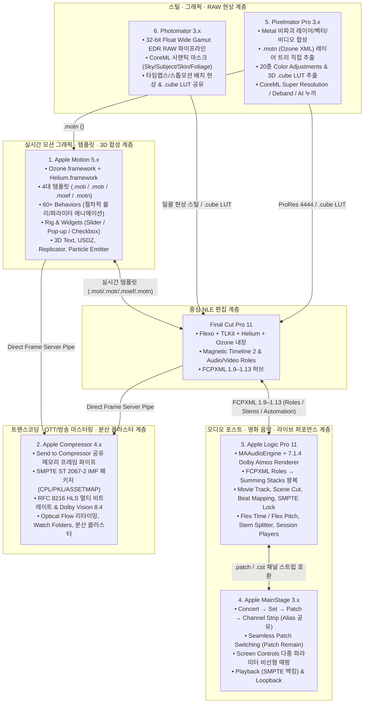
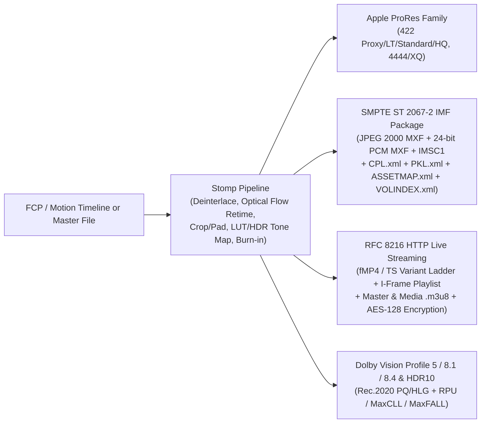
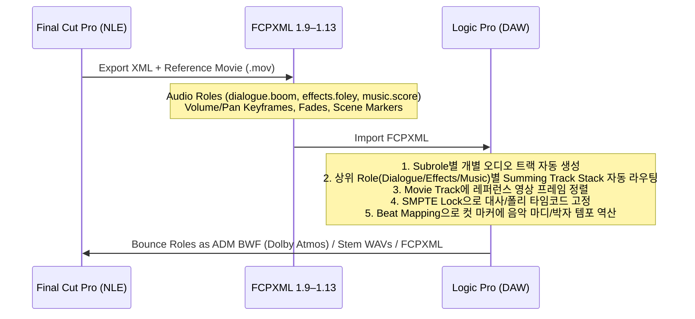
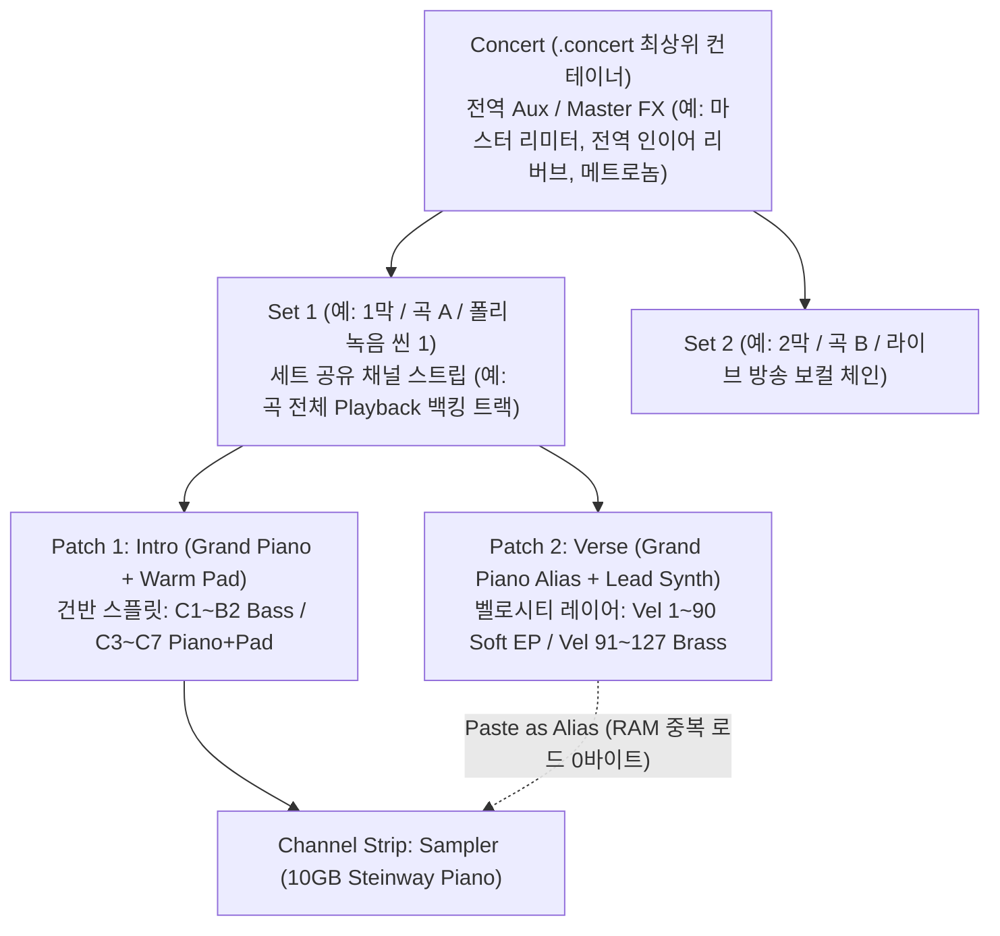
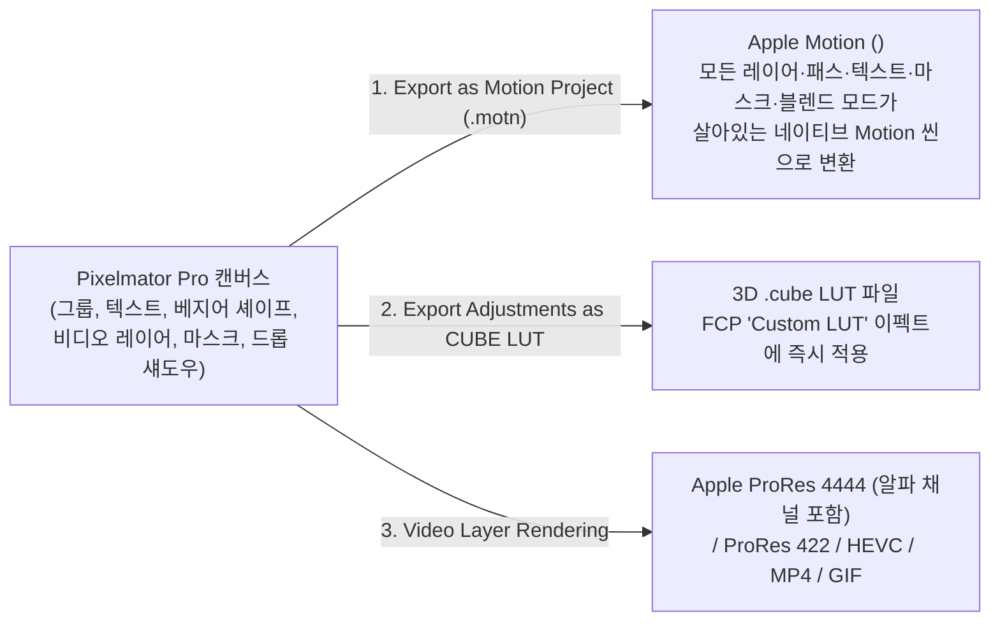
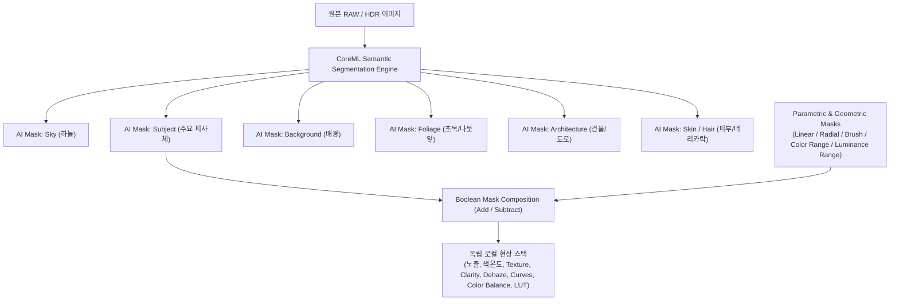

# Apple Pro Apps 생태계 6대 동반 애플리케이션(Motion · Compressor · Logic Pro · MainStage · Pixelmator Pro · Photomator) 전 기능 & 아키텍처 심층 해부 보고서

본 문서는 **Final Cut Pro**를 둘러싼 Apple의 6대 프로페셔널 제작 애플리케이션 — **Apple Motion 5.x**, **Apple Compressor 4.x**, **Apple Logic Pro 10.x/11.x**, **Apple MainStage 3.x**, **Pixelmator Pro 3.x**, **Photomator 3.x** — 각각의 **내부 프레임워크(`Ozone`, `Helium`, `Stomp`, `MAAudioEngine`, `Metal`, `CoreML`), 네이티브 파일 포맷(`.motn`/`<ozml>`, `.batch`, `.logicx`, `.concert`, `.pxd`, `.photo-edit`), 세부 기능 전체 카탈로그, 알고리즘 원리, Final Cut Pro와의 실시간 파이프라인 연동 구조**, 그리고 **ArtCraft 6대 앱(EffectCraft, FilmCraft, SoundCraft, PhotoCraft, VectorCraft, LightCraft)** 과의 1:1 아키텍처 매핑을 망라한 심층 레퍼런스입니다.

---

## 1. Apple Motion (5.x) — 실시간 모션 그래픽 · 3D VFX · FCP 템플릿 저작 엔진

### 1.1 내부 아키텍처 & `<ozml>` 파일 포맷 해부
* **핵심 프레임워크**:
  * `Ozone.framework`: 씬 그래프(`OZScene`, `OZGroup`, `OZLayer`), 절차적 동작(`OZBehavior`), 리그(`OZRig`, `OZWidget`), 파티클(`OZParticleEmitter`), 리플리케이터(`OZReplicator`), 3D 카메라/조명 연산.
  * `Helium.framework`: Final Cut Pro와 100% 동일한 GPU 렌더 그래프(`HGNode`)를 공유합니다. 이 때문에 Motion에서 저장한 템플릿은 FCP 안에서 별도 플러그인이나 코덱 렌더링 없이 **네이티브 타임라인 노드로 즉시 합류**합니다.
* **네이티브 XML 포맷 (`<ozml version="5.10">`)**:
  * 확장자만 용도에 따라 4가지로 나뉘며 내부는 모두 UTF-8 XML 문서입니다:
    1. **`.motn` (Motion Project / FCP Generator)**: 일반 프로젝트 또는 FCP의 제너레이터(절차적 배경, 카운트다운 등).
    2. **`.moti` (FCP Title)**: FCP 자막 브라우저에 등록되는 타이틀 템플릿 (`<template>` 플래그 및 `Title Background` 플레이스홀더 포함).
    3. **`.motr` (FCP Transition)**: `Transition A` (나가는 클립)와 `Transition B` (들어오는 클립) 두 개의 타임라인 플레이스홀더 레이어를 포함하는 커스텀 트랜지션.
    4. **`.moef` (FCP Effect)**: `Effect Source` 플레이스홀더에 필터 체인, 컬러 룩, 프레임, 왜곡을 적용해 FCP 클립에 얹는 이펙트 프리셋.

### 1.2 Rigging & Widgets (리그 및 위젯 퍼블리싱 아키텍처)
Final Cut Pro 사용자가 복잡한 레이어 트리를 열지 않고도 인스펙터의 직관적인 컨트롤 몇 개만으로 디자인을 변형할 수 있게 만드는 Motion만의 핵심 시스템입니다.

| 위젯 종류 (`OZWidget`) | 동작 방식 및 멀티 파라미터 바인딩 구조 | 실무 활용 예시 |
| :--- | :--- | :--- |
| **Checkbox Widget** | `Checked (True)` 상태와 `Unchecked (False)` 상태 두 가지 스냅샷(Snapshot)에 수십 개의 레이어 가시성(`Opacity`), 위치(`Position`), 필터 활성 상태를 동시에 기록합니다. | `"배경 블러 켜기/끄기"` 체크박스 하나로 블러 필터 Amount + 어두운 오버레이 Opacity + 텍스트 그림자를 동시에 전환. |
| **Pop-up Widget** | 드롭다운 메뉴의 항목(`Item 1`, `Item 2`, `Item 3`...)마다 완전히 다른 레이어 배치·색상 테마·애니메이션 상태를 스냅샷으로 저장합니다. | `"레이아웃 선택: 좌측 정렬 / 중앙 정렬 / 우측 하단 로어써드"` 드롭다운 메뉴 하나로 타이틀 위치·앵커·배경 박스 길이를 일괄 변경. |
| **Slider Widget** | `0` ~ `100` 연속 구간 위에 여러 개의 중간 스냅샷 태그(Interpolation Tags)를 찍어, 슬라이더 하나를 움직일 때 위치는 선형으로, 크기는 비선형으로, 색상은 파랑→보라→빨강으로 동시에 보간합니다. | `"에너지 레벨"` 슬라이더 하나로 파티클 방출 속도 + 카메라 흔들림(Wriggle) + 글로우 강도를 동시 제어. |

* **Published Parameters (`<publishedParameters>`)**:
  * 어떤 파라미터나 위젯이든 우클릭 → `Publish`를 선택하면 `<publishedParameters>` 블록에 등록되어 Final Cut Pro의 Title/Effect/Generator 인스펙터 최상단에 노출됩니다.

### 1.3 템플릿 반응형 타이밍 마커 (Adaptive Timing Markers) & Auto-Layout
FCP 타임라인에서 사용자가 5초짜리 타이틀 템플릿을 20초로 늘리거나 2초로 줄일 때 애니메이션 속도가 깨지지 않도록 제어하는 마커 규칙입니다:
1. **`Build In - Optional` / `Build In - Mandatory`**:
   - 시작점부터 이 마커까지의 프레임(예: 처음 30프레임 등장 모션)은 클립 전체 길이를 아무리 늘려도 **원래의 재생 속도(30프레임)를 절대 유지**합니다. `Optional`로 지정하면 FCP 인스펙터에 `Build In` 체크박스가 자동으로 생겨 사용자가 등장 애니메이션 자체를 켜고 끌 수 있습니다.
2. **`Build Out - Optional` / `Build Out - Mandatory`**:
   - 이 마커부터 클립 끝까지의 퇴장 애니메이션 속도를 고정합니다.
3. **`Project Loop End`**:
   - 제너레이터나 배경 루프 그래픽이 클립 길이가 늘어날 때 스트레칭되는 대신 자연스럽게 반복(Loop)되도록 지정합니다.
4. **Aspect Ratio Snapshots (반응형 종횡비 스냅샷)**:
   - 하나의 템플릿 안에 `16:9`, `9:16`(세로형), `1:1`(정방형), `4:5` 등 여러 화면비 스냅샷을 등록해 두면, FCP 프로젝트의 화면비에 맞춰 Motion 템플릿이 레이아웃을 자동으로 재배치합니다.

### 1.4 60종 이상의 절차적 Behavior 카탈로그 (No-Keyframe Animation Engine)
Motion은 키프레임을 일일이 찍거나 복잡한 JavaScript 수식을 코딩하지 않고도 **Behavior 블록들을 레고처럼 레이어나 개별 파라미터에 쌓아 합성(Additive Composition)** 하는 독창적인 절차적 애니메이션 엔진을 제공합니다.

| Behavior 카테고리 | 전체 세부 Behavior 목록 및 수학적 동작 원리 |
| :--- | :--- |
| **1. Basic Motion (기본 모션 8종)** | • **Throw**: 지정된 3D 속도 벡터($v_x, v_y, v_z$)로 등속 운동. • **Spin**: 초당 지정된 각도($^\circ/\text{sec}$)로 3축 정속 회전. • **Grow/Shrink**: 일정 비율로 스케일 연속 확대/축소. • **Fade In/Fade Out**: 클립 시작/끝 프레임 구간 동안 자동으로 Opacity $0 \leftrightarrow 100\%$ 가감. • **Motion Path**: 3D 베지어 스플라인 경로를 따라 오브젝트 이동. • **Snap Alignment to Motion**: 이동 경로의 접선(Tangent) 벡터 방향으로 오브젝트를 자동 회전 정렬. • **Point At** / **Move**: 특정 타겟 오브젝트를 항상 바라보거나 지정된 목표 좌표까지 Ease-In/Out 이동. |
| **2. Parameter Behaviors (파라미터 제어 17종)** | 위치, 회전, 스케일뿐만 아니라 필터 강도, 색상, 글자 자간 등 **모든 수치형 파라미터에 부착 가능**: • **Oscillate**: 사인파($\sin$), 구형파(Square), 삼각파(Triangle), 톱니파(Sawtooth) 주기 진동 ($A \cdot \sin(2\pi f t + \phi)$). • **Wriggle**: 펄린 노이즈(Perlin Noise) 기반 불규칙 흔들림(카메라 핸드헬드 쉐이크, 네온 깜빡임). • **Overshoot**: 목표값 도달 시 용수철처럼 튕기며 감쇠 진동(Damped Harmonic Oscillator) 후 안착. • **Ramp** / **Exponential** / **Logarithmic** / **Rate**: 시간에 따른 선형/지수/로그 변화. • **Quantize**: 연속적인 움직임을 계단식(`Step Size`) 스톱모션 느낌으로 양자화. • **Link**: 다른 레이어의 파라미터(예: 원의 X 위치)를 현재 파라미터(예: 사각형의 회전 각도)에 비례(`Scale`)/오프셋(`Offset`)으로 직결. • **Audio**: 오디오 트랙의 특정 주파수 대역(Bass/Mid/Treble) 진폭이나 트랜지언트 피크를 읽어 파라미터를 실시간 구동(오디오 리액티브 비주얼라이저). • **MIDI**: 외장 MIDI 건반/노브 신호로 파라미터 제어. • **Reverse** / **Negate** / **Stop** / **Randomize** / **Track**. |
| **3. Simulation Behaviors (물리 시뮬레이션 12종)** | 다수의 레이어·파티클·텍스트 글자들 간의 상호 물리장 시뮬레이션: • **Gravity**: 중력 가속도 벡터 낙하. • **Edge Collision**: 캔버스 경계면 또는 3D 박스 벽면에 부딪혀 탄성 반사(`Bounce Strength`). • **Attractor** / **Attracted To**: 만유인력처럼 주변 오브젝트들을 끌어당김. • **Repel** / **Repel From**: 자석 같은 극처럼 주변 오브젝트들을 밀어냄. • **Vortex** / **Orbit Around**: 중심축 주위를 소용돌이/궤도 공전. • **Spring**: 두 오브젝트를 보이지 않는 탄성 스프링으로 연결. • **Drift** / **Random Motion** / **Wind**. |
| **4. Text Behaviors (타이포그래피 5종)** | • **Sequence Text**: 글자(`Character`), 단어(`Word`), 줄(`Line`), 전체(`All`) 단위로 순차 오프셋을 주어 위치·회전·스케일·불투명도·글자색·외곽선·자간·블러를 파도타기처럼 애니메이션. • **Type On**: 타자기 타이핑 효과. • **Scroll Text**: 영화 엔딩 크레딧처럼 픽셀 단위로 떨림 없는(Anti-aliased Subpixel) 수직/수평 스크롤. • **Tracking** / **Arrange Text In**. |
| **5. Shape & Mask Behaviors (3종)** | • **Write On**: 베지어 패스의 `Start`/`End` 트림 오프셋을 애니메이션하여 손글씨나 네온 라인이 스스로 그려지는 효과. • **Track Points**: 베지어 셰이프나 마스크의 개별 버텍스(Knot) 하나하나를 모션 트래커에 바인딩해 로토스코핑 자동화. • **Oscillate Shape**. |

### 1.5 Replicator · Particle Emitter · 3D Workspace & USDZ
* **Replicator (`OZReplicator`)**:
  * 하나 이상의 소스 레이어(Cell)를 기하학적 패턴(`Line`, `Rectangle`, `Circle`, `Burst`, `Spiral`, `Wave`, `Box`, `Sphere`, 또는 다른 이미지/텍스트의 알파 형태인 `Image`)을 따라 수백~수천 개로 복제 배열합니다.
  * `Sequence Replicator` Behavior를 얹으면 수천 개의 복제 셀을 가로/세로/중심으로부터 순차적으로 회전·색상 변환·확대하는 스타디움 전광판급 모션을 키프레임 하나 없이 구현합니다.
* **Particle Emitter (`OZParticleEmitter`)**:
  * 2D/3D 공간 입자 방출기. `Birth Rate`, `Initial Number`, `Life`, `Speed`, `Angle`, `Spin`, `Scale Over Life`, `Opacity Over Life`, `Color Over Life` 그라디언트 및 `Additive` 블렌딩으로 연기, 불꽃, 눈, 비, 보케(Bokeh) 빛망울을 실시간 생성합니다.
* **3D 공간 · 카메라 · 조명 · USDZ 3D 모델**:
  * **3D Camera**: `Framing` 및 `Viewpoint` 카메라, 물리적 초점 거리(`Focal Length`), 피사계 심도(`Depth of Field` — `DOF Blur Amount`, `Focus Offset`, `Near/Far Focus`, 커스텀 조리개 보케 모양 `Polygon`/`Layer` 지원).
  * **3D Lights**: `Ambient`, `Directional`, `Point`, `Spot` 조명 및 실시간 소프트 그림자(`Shadows`), 반사(`Reflections`).
  * **3D Objects (`USDZ`)**: Pixar/Apple 표준 `.usdz` 3D 에셋을 임포트하여 내부 스켈레탈 애니메이션을 재생하고 3D 텍스트·파티클과 같은 3D 공간에서 교차(Depth Intersection) 합성합니다.

### 1.6 ArtCraft 대응: **[EffectCraft](../effectcraft)** (32개 크레이트)
* [`effectcraft-interchange::motion`](../effectcraft/crates/interchange/src/motion.rs)에서 `<ozml version="5.10">` (`.motn`, `.moti`, `.motr`, `.moef`)의 양방향 임포트/익스포트, Motion Behavior(`Oscillate`, `Spin`, `Throw`, `FadeInFadeOut`) ↔ [`effectcraft-expr`](../effectcraft/crates/expr) 수식 및 키프레임 변환, `<publishedParameters>` & `dropZone="1"` ↔ [`EssentialGraphics`](../effectcraft/crates/project/src/essential.rs) 연동이 구현되어 있습니다.

---

## 2. Apple Compressor (4.x) — 트랜스코딩 · 방송/OTT 패키징 · 분산 클러스터 엔진

### 2.1 내부 아키텍처 & FCP/Motion 직접 프레임 파이프
* **핵심 프레임워크**: `CompressorKit.framework`, `Stomp.framework` (인코딩 파이프라인 코어), `Qmaster.framework` (분산 클러스터 노드 스케줄러), `VideoToolbox`.
* **`Send to Compressor` 공유 메모리 프레임 서버**:
  * Final Cut Pro나 Motion에서 `Send to Compressor`를 실행하면, 디스크에 수백 GB짜리 임시 ProRes 파일을 먼저 렌더링하지 않고 FCP의 `Helium` 렌더러가 생성한 비압축 프레임을 프로세스 간 파이프(IPC Shared Memory)로 Compressor의 다중 인코더 스레드에 직접 공급합니다.

### 2.2 방송 · 시네마 · OTT 마스터링 패키징 규격

1. **SMPTE IMF (Interoperable Master Format) Package 빌더**:
   - Netflix, Disney+, Sony Pictures 등 글로벌 스튜디오 납품 표준인 **SMPTE ST 2067-2 / ST 2067-21 (Application #2E)** 패키지를 생성합니다:
     - **Video Track**: `JPEG 2000` (Kakadu/Apple J2K) Broadcast Profile Level 1~7, `.mxf` (OP1a) 래핑, SDR/HDR(PQ/HLG) 색공간.
     - **Audio Tracks**: 24-bit 48kHz 비압축 PCM `.mxf` (5.1 Surround, 7.1, Stereo M&E 트랙 분리).
     - **Caption / Timed Text Tracks**: SMPTE-TT / IMSC1 XML `.mxf`.
     - **패키지 매니페스트 4종**: `CPL_<uuid>.xml` (Composition Playlist: 릴/에피소드 타임라인 조합 정의), `PKL_<uuid>.xml` (Packing List: 모든 에셋의 SHA-1 해시 및 바이트 크기 검증), `ASSETMAP.xml` (UUID ↔ 실제 파일 경로 매핑), `VOLINDEX.xml` (볼륨 인덱스).
     - **Supplemental IMF Package**: 2시간짜리 본편 영화에서 오타가 난 자막 3초나 수정된 VFX 1컷만 재인코딩하여, 원본 수백 GB 파일을 다시 보내지 않고 수정된 조각과 새 `CPL.xml`만 납품하는 차등 패키지 기능.
2. **HTTP Live Streaming (HLS, RFC 8216) 적응형 스트리밍 빌더**:
   - 단일 소스로부터 모바일 셀룰러(`360p`/`540p`), HD(`720p`/`1080p`), 4K UHD(`2160p`)까지 여러 개의 비트레이트/해상도/코덱(`H.264` + `HEVC`) Variant 스트림을 동시에 인코딩합니다.
   - 세그먼트 포맷: 조각화 MP4 (`Fragmented MP4 / CMAF .m4s` + `#EXT-X-MAP` 초기화 헤더 또는 `#EXT-X-BYTERANGE` 단일 파일 바이트 레인지) 및 전통적 `MPEG-2 TS (.ts)`.
   - 고속 탐색(Scrubbing)용 `#EXT-X-I-FRAME-STREAM-INF` 전용 플레이리스트 및 다국어/Dolby Atmos `#EXT-X-MEDIA:TYPE=AUDIO` 그룹 매니페스트 자동 생성.
3. **Dolby Vision (Profile 5 / 8.1 / 8.4) & HDR10 마스터링**:
   - 동적 메타데이터(RPU) 보존 및 `MaxCLL`(Maximum Content Light Level), `MaxFALL`(Maximum Frame-Average Light Level), 마스터링 모니터 색역(P3-D65 / Rec.2020) SEI 메시지 주입.

### 2.3 Optical Flow 프레임 레이트 변환 & 비디오/오디오 필터 체인
* **Retiming & Frame Rate Conversion (`Rate Conversion` 품질 4단계)**:
  1. `Fast (Nearest Frame)`: 가장 가까운 프레임 복제/드롭.
  2. `Good (Frame Blending)`: 인접 프레임 블렌딩.
  3. `Better (Motion Compensated)`: 블록 매칭 모션 보상.
  4. `Best (Optical Flow)`: 픽셀 단위 광학 흐름 벡터로 `23.976fps` 시네마 마스터를 유럽 방송용 `25fps (PAL)` 또는 `50i`/`59.94p`로 아티팩트 없이 변환(또는 오디오 피치 보정과 함께 4% PAL Speed-up 수행).
* **Deinterlacing & Reverse Telecine**:
  * `Reverse Telecine`: `29.97i` 영상에 삽입된 `3:2 Pulldown` 케이던스(`AA BB BC CD DD`)를 감지해 원본 `23.976p` 프로그레시브 프레임을 완벽히 복원.
* **내장 필터 & 지오메트리**:
  * 자동 레터박스(Black Bar) 크롭 감지, 타임코드 생성기 번인(Timecode Burn-in), 알파 채널 비디오/스틸 워터마크, 색공간 변환 및 `.cube` LUT 적용, 방송 라우드니스 정규화(`EBU R128 -23 LUFS` / `ATSC A/85 -24 LKFS` / True Peak `-1 dBTP` 리미팅).

### 2.4 Watch Folders · Job Actions · 분산 네트워크 클러스터
* **Watch Folders (감시 폴더)**: 지정된 로컬/NAS 디렉터리에 영상 파일이 복사되어 들어오면 자동으로 감지해 지정된 Destination Bundle로 인코딩하고 원본을 완료 폴더로 이동합니다.
* **Job Actions**: 인코딩 완료 직후 셸 스크립트/Automator 실행, 웹 서버 업로드, 이메일/알림 발송 자동화.
* **Shared Computers (분산 인코딩 클러스터)**: 로컬 네트워크의 여러 Mac을 하나의 클러스터 그룹으로 묶어 장편 고해상도 영상을 프레임 청크(Chunk) 단위로 쪼개 병렬 인코딩합니다.

### 2.5 ArtCraft 대응: **[FilmCraft](../filmcraft)** (`filmcraft-export` + 25개 코덱/컨테이너 크레이트)
* [`filmcraft/crates/export/src/compressor.rs`](../filmcraft/crates/export/src/compressor.rs)에 RFC 8216 HLS 마스터/미디어 매니페스트 빌더(`build_hls_master_playlist`, `build_hls_media_playlist`, `HlsRendition::standard_abr_ladder`), SMPTE ST 2067-2 IMF 패키지 4종 XML 생성기(`build_imf_package_xmls`), 다중 출력 [`DestinationBundle`](../filmcraft/crates/export/src/compressor.rs), 감시 폴더 규칙 [`WatchFolderRule`](../filmcraft/crates/export/src/compressor.rs)이 구현되어 있으며, 순수 Rust 코덱 크레이트(`prores`, `dnx`, `h264enc`, `hevc`, `av1`, `vp9`, `apv`, `mxf`, `isobmff`, `aac`, `ac3`, `opus`, `flac`)와 결합됩니다.

---

## 3. Apple Logic Pro (10.x – 11.x) — 오디오 포스트 프로덕션 · 영화 음악 스코어링 · Dolby Atmos 마스터링

### 3.1 내부 오디오 엔진 아키텍처 (`MAAudioEngine`)
* **이중 버퍼 하이브리드 스케줄링 (Dual-Buffer Hybrid Threading)**:
  * **Live Input Thread (초저지연 버퍼: 32 ~ 128 samples)**: 현재 녹음(Record-armed) 중이거나 입력 모니터링 중인 트랙만 최소 I/O 버퍼 크기로 처리하여 연주 지연(Latency)을 2~3ms 이하로 유지합니다.
  * **Playback Thread (고효율 대용량 버퍼: 1024 samples)**: 이미 녹음된 수백 개의 재생 전용 오디오/가상악기 트랙은 큰 버퍼로 미리 앞당겨(Lookahead) 멀티코어 CPU(P-Core & E-Core)에 분산 처리함으로써 CPU 오버로드를 방지합니다.
* **Sample-Accurate Automation & Plug-in Delay Compensation (PDC)**:
  * 볼륨, 팬, 플러그인 파라미터 오토메이션을 MIDI 틱이 아닌 **오디오 샘플 단위**로 램프 보간하며, 리니어 페이즈 EQ나 리미터가 유발하는 레이턴시를 모든 버스/보조 트랙에 걸쳐 샘플 단위로 자동 보상합니다.

### 3.2 Final Cut Pro ↔ Logic Pro FCPXML 왕복 & 영화 음악 스코어링 (Scoring to Picture)

1. **FCPXML Audio Roles → Track Stacks (Summing Stacks) 자동 구성**:
   - FCP에서 넘어온 `role="dialogue.actor1"`, `role="dialogue.actor2"` 클립들은 각각 개별 오디오 트랙으로 배치되고, 자동으로 **`Dialogue` Summing Stack (서밍 버스)** 아래로 묶입니다. `Effects`와 `Music`도 동일하게 스템 버스로 묶여 대사 전체, 효과음 전체, 음악 전체의 스템 믹싱과 라우드니스 제어가 즉시 가능해집니다.
2. **Movie Track & Scene Cut Detection**:
   - 영상을 플로팅 윈도우나 글로벌 `Movie Track` 썸네일 스트립으로 열어 프레임 단위로 스크러빙하며, 컷 전환 지점을 자동 검출해 **Scene Markers**(타임코드 고정 마커)를 생성합니다.
3. **SMPTE Lock (`Lock SMPTE Position`)**:
   - 영화 음악 작곡 도중 곡의 템포(예: `120 BPM` → `132 BPM`)를 바꾸면 일반 음악 트랙(Ticks Timebase)의 MIDI/오디오 리전들은 마디(Bar)를 따라 이동하지만, **SMPTE Lock이 걸린 대사(Dialogue)와 폴리 효과음(Foley SFX) 리전들은 영상의 절대 타임코드 프레임 위치(`01:04:12:18`)에 못 박힌 듯 그대로 유지**됩니다.
4. **Beat Mapping (비트 매핑 — 마커 기반 자동 템포 역산)**:
   - 영상의 중요한 타격점(문 닫히는 순간, 폭발 프레임, 컷 전환 마커)에 음악의 특정 마디/박자(예: `Bar 9 Beat 1`) 선을 마우스로 끌어다 놓으면, 앞 구간과 해당 타격점 사이의 정확한 BPM($\text{BPM} = \frac{60 \times \Delta\text{Beats}}{\Delta t_{\text{seconds}}}$)을 자동 계산하여 **Tempo Track에 템포 변화 이벤트를 삽입**합니다.

### 3.3 Dolby Atmos & Spatial Audio (공간 음향 마스터링)
* **통합 7.1.4 Dolby Atmos 렌더러**:
  * 별도의 외부 Dolby Atmos Production Suite 앱 없이 Logic Pro 믹서 내부에서 **`7.1.4` Bed 트랙**과 최대 **118개의 독립 3D Object 트랙**을 동시에 라우팅합니다.
* **3D Object Panner**:
  * 각 오브젝트 사운드를 3차원 직교 좌표($X$: 좌/우, $Y$: 전/후, $Z$: 높이 Elevation) 또는 구면 좌표(Azimuth, Elevation, Distance)로 이동시키고 `Spread`(음원 크기)를 키프레임 오토메이션합니다.
* **Binaural Renderer & Apple Spatial Audio 모니터링**:
  * `Dolby Binaural` 모드뿐만 아니라 **`Apple Spatial Audio`** 렌더러 프로파일을 내장하여, AirPods Pro / Max의 동적 헤드 트래킹(Dynamic Head Tracking) 및 개인 맞춤형 HRTF에서 실제로 어떻게 들릴지 스튜디오에서 100% 동일하게 모니터링합니다.
* **ADM BWF (`.wav` Audio Definition Model Broadcast Wave) 익스포트**:
  * 멀티채널 오디오 샘플과 3D 오브젝트 좌표 메타데이터(`axml`, `chna` 청크)가 담긴 단일 ADM BWF 마스터 파일로 익스포트하며, 이 파일을 Final Cut Pro나 Apple Music에 바로 납품할 수 있습니다.

### 3.4 Flex Time · Flex Pitch · Smart Tempo
* **Flex Time (비파괴 타임 워핑 6대 알고리즘)**:
  1. `Slicing`: 타악기/드럼 트랜지언트(Transient) 지점을 잘라 시간 압축/팽창 시 위상 왜곡이 전혀 없음.
  2. `Rhythmic`: 리듬 기타, 건반 연주용.
  3. `Monophonic`: 솔로 보컬, 단선율 관악기/베이스 (ADR 후시녹음 대사 입모양 싱크 맞출 때 필수).
  4. `Polyphonic`: 피아노 코드, 어쿠스틱 기타 스트로크, 풀 믹스 등 다성 화음 복합 신호용 최고급 위상 보코더.
  5. `Speed (FX)`: 테이프 재생 속도를 바꾸듯 길이와 피치를 함께 변화.
  6. `Tempophone`: 빈티지 테이프 그래뉼러 에뮬레이션.
* **Flex Pitch (내장 멜로다인급 노트 보정기)**:
  * 오디오 파형 위에 검출된 음정 빔(Note Beam)의 6개 핫스팟 핸들로 **Pitch Drift (음 시작/끝의 흔들림)**, **Fine Pitch (센트 단위 미세 음정)**, **Gain (음절별 음량)**, **Vibrato (비브라토 진폭)**, **Formant Shift (음정 변경 시 다람쥐 목소리 현상을 막는 성도 포먼트 보정)** 를 비파괴로 편집합니다.
* **Smart Tempo (`Keep` / `Adapt` / `Automatic`)**:
  * 메트로놈(클릭) 없이 자유롭게 연주한 오디오/MIDI 녹음본의 박자 변화를 AI가 분석해 프로젝트 템포 맵을 연주에 맞추거나(`Adapt`), 반대로 자유 템포 오디오를 프로젝트 고정 템포에 자동으로 정렬(`Keep`)합니다.

### 3.5 Logic Pro 11 온디바이스 AI 기능군 & 플래그십 악기
1. **Stem Splitter (AI 4-Stem 분리기)**:
   - 이미 마스터링된 스테레오 투트랙 오디오 파일에서 **`Vocals`**, **`Drums`**, **`Bass`**, **`Other` (기타/피아노/스트링)** 4개의 독립 스템 트랙을 Apple Silicon Neural Engine으로 수 초 만에 고음질 분리합니다.
2. **Session Players (AI Drummer · Bass Player · Keyboard Player)**:
   - 글로벌 `Chord Track`(코드 진행 트랙)을 따라 실시간으로 연주를 생성하는 가상 세션 연주자입니다.
   - `Complexity` / `Intensity` XY 패드, 주법(예: Bass의 Slap / Pick / Finger, Keyboard의 Broken Chords / Block Chords / Arpeggio, 왼손/오른손 음역대), 필인(`Fill Amount`), 특정 다른 트랙의 리듬을 따라가는 `Follow Track` 기능을 제공합니다.
3. **ChromaGlow & Mastering Assistant**:
   - `ChromaGlow`: 5가지 신경망 모델링 아날로그 새추레이션(`Modern Tube`, `Magnetic`, `Squeeze`, `Retro Tube`, `Vintage Console`).
   - `Mastering Assistant`: 마스터 버스 전체 스펙트럼과 다이내믹 레인지를 분석해 4가지 사운드 캐릭터(`Clean`, `Valve`, `Punch`, `Transparent`) 기반의 보상 EQ 커브, 스테레오 이미저(`Width`), 익사이터(`Excite`), 스트리밍 표준(`-14 LUFS`) 라우드니스 리미터를 자동 설정합니다.
4. **플래그십 신디사이저 · 샘플러 · 시퀀서**:
   - `Alchemy` (가산/스펙트럴/그래뉼러/버추얼 아날로그 4-소스 모핑 신스), `Sampler` & `Quick Sampler`, `Step Sequencer` (노트 반복, 확률 `Chance`, 벨로시티/게이트/루프 시작점 행별 독립 제어), `Live Loops` (비선형 셀 매트릭스 퍼포먼스), `MIDI Environment` & JavaScript `Scripter`.

### 3.6 ArtCraft 대응: **[SoundCraft](../soundcraft)** (14개 크레이트)
* [`soundcraft-model::fcpxml`](../soundcraft/crates/model/src/fcpxml.rs)에서 FCPXML 1.9–1.13 Audio Roles(`Dialogue`/`Effects`/`Music`) 스템 트랙 & Summing Bus 자동 라우팅 왕복, `smpte_lock_clips` (SMPTE 잠금), `beat_map_markers_to_tempo` (마커 기반 템포 역산)를 구현했으며, [`soundcraft-video`](../soundcraft/crates/video), [`soundcraft-dsp`](../soundcraft/crates/dsp), [`soundcraft-mix`](../soundcraft/crates/mix), [`soundcraft-midi`](../soundcraft/crates/midi), [`soundcraft-automation`](../soundcraft/crates/automation), 그리고 3대 플러그인 호스트(`au-host`, `vst3-host`, `clap-host`)를 갖추고 있습니다.

---

## 4. Apple MainStage (3.x) — 초저지연 라이브 퍼포먼스 · 폴리(Foley)/성우/악기 랙 엔진

### 4.1 4계층 아키텍처 (`Concert → Set → Patch → Channel Strip`) & Alias 메모리 공유

1. **계층적 신호 오버라이드 및 상속**:
   - **Concert 레벨**에 추가한 채널 스트립(예: 아나운서 마이크 컴프레서나 마스터 리버브)은 콘서트 내의 모든 패치를 전환하더라도 항상 끊김 없이 활성 상태를 유지합니다.
   - **Set 레벨**에 추가한 채널 스트립은 해당 세트에 속한 패치들 사이에서만 유지됩니다.
   - **Patch 레벨** 채널 스트립은 해당 패치가 선택되었을 때만 활성화됩니다.
2. **Alias Channel Strips (`Paste as Alias`)**:
   - 50개의 패치에서 모두 10GB짜리 대용량 콘서트 그랜드 피아노 샘플러를 사용할 때, 패치마다 샘플러를 복사하면 500GB의 RAM이 필요하지만 MainStage의 **Alias Channel Strip**은 단 1개의 플러그인 인스턴스 메모리를 50개 패치가 포인터로 공유하면서 패치별 볼륨·센드·건반 스플릿 범위만 다르게 설정할 수 있습니다.

### 4.2 Seamless Patch Switching (`Patch Remain` 보이스 & 테일 보존 알고리즘)
라이브 연주나 실시간 방송 중 가장 치명적인 문제는 패치 1에서 피아노 코드와 서스테인 페달을 밟은 채 패치 2(신디사이저)로 넘어갈 때 피아노 소리가 칼로 자른 듯 뚝 끊기는 현상입니다. MainStage의 **`Patch Remain`** 엔진은 이를 두 단계로 해결합니다:
1. **Active MIDI Note Tracking (`Held Voice Retention`)**:
   - 패치 1에서 패치 2로 전환되는 순간, 패치 1에 아직 `NoteOff`(또는 Sustain Pedal `CC#64 = 0`)가 도착하지 않은 열린 노트 목록을 추적합니다.
   - 새로 눌리는 건반(`NoteOn`)은 즉시 패치 2의 신디사이저로만 라우팅되지만, **이전에 누르고 있던 건반의 `NoteOff` 이벤트는 패치 1의 신디사이저로 전달될 때까지 패치 1의 DSP 오디오 합산을 계속 유지**합니다.
2. **Audio DSP Tail Decay (`Reverb / Delay Tail Window`)**:
   - 모든 건반에서 손을 뗀 직후에도 패치 1에 걸려 있는 리버브나 딜레이 잔향이 완전히 소멸될 때까지 지정된 감쇠 시간(`Tail Decay Samples`) 동안 패치 1의 오디오 출력을 마스터 버스에 계속 합산한 뒤 부드럽게 절전(Bypass) 상태로 전환합니다.

### 4.3 Layout · Edit · Perform 3대 모드 & 다중 파라미터 매크로(Screen Controls)
* **Layout Mode**: 물리적 MIDI 컨트롤러의 노브, 페이더, 페달, 드럼 패드와 똑같은 화면 위젯(**Screen Controls**)을 배치하고 `Assign` 버튼으로 하드웨어 MIDI CC/Note 신호를 학습시킵니다.
* **Edit Mode — 1:N Multi-Parameter Mapping & Custom Scaling Curves**:
  * 단 하나의 하드웨어 매크로 노브(`Macro Knob 1`)에 다음과 같이 서로 다른 채널 스트립의 파라미터 4개를 동시에 연결할 수 있습니다:
    1. 신스 필터 `Cutoff Frequency`: `200 Hz` → `12,000 Hz` (지수 곡선)
    2. 디스토션 `Drive`: `0 dB` → `+18 dB` (선형)
    3. 리버브 `Wet Mix`: `10%` → `65%` (S-커브)
    4. 패드 레이어 `Volume`: `0 dB` → `-∞ dB` (**Invert Range 역방향 매핑**: 노브를 올릴수록 패드는 줄어들고 리드 신스가 커지는 크로스페이드)
* **Floating Key Range & Velocity Layering**:
  * 채널 스트립마다 건반 음역대(`Note Low` ~ `Note High`), 경계면 볼륨 크로스페이드(`Key Scaling`), 벨로시티 반응 구간(`Velocity Low` ~ `Velocity High`), 반음/옥타브 `Transpose`를 그래픽 건반 뷰에서 설정합니다.
* **`Playback` & `Loopback` 전용 라이브 플러그인**:
  * `Playback`: SMPTE 타임코드 및 마커가 내장된 멀티스템 백킹 트랙을 Sync Group으로 묶어 클릭 트랙과 함께 재생하고 실시간으로 Verse/Chorus 마커 구간으로 점프.
  * `Loopback`: 첫 루프 길이에 맞춰 템포를 자동 계산하거나 콘서트 템포에 동기화되는 멀티트랙 라이브 루퍼.

### 4.4 ArtCraft 대응: **[SoundCraft](../soundcraft)** ([`soundcraft-model::mainstage`](../soundcraft/crates/model/src/mainstage.rs))
* [`soundcraft/crates/model/src/mainstage.rs`](../soundcraft/crates/model/src/mainstage.rs)에 `Concert`, `PatchSet`, `Patch`, `ChannelStripConfig` (건반 스플릿 `note_low..=note_high`, 벨로시티 레이어 `vel_low..=vel_high`, `transpose`), `MacroControl` / `MacroMapping` (1:N 매크로 CC 팬아웃 및 역방향 스케일링), 그리고 열린 노트(`NoteOff` 추적)와 잔향 테일(`tail_decay_samples`)을 보존하는 **`LivePatchSwitcher` (`Patch Remain`)** 가 완벽히 구현되어 있습니다.

---

## 5. Pixelmator Pro (3.x) — Metal 레이어/벡터/비디오 디자인 · `.motn` 익스포트 · CoreML AI 스위트

### 5.1 내부 아키텍처 & 8대 비파괴 레이어 엔진
* **핵심 프레임워크**: `Metal` 타일 기반 16-bit/32-bit Float 비파괴 합성 파이프라인, `CoreML` & `BNNS` 온디바이스 신경망, `CoreText`, `.pxd` 패키지 아키텍처.
* **8종 레이어 타입**:
  1. `Image Layer` (래스터 픽셀)
  2. **`Video Layer` (동영상 클립 레이어)**
  3. `Shape Layer` (파라메트릭 스마트 셰이프 & 3차 베지어 벡터 패스)
  4. `Text Layer` (일반 텍스트, 원형/베지어 패스 위를 흐르는 **Path Text**, SVG 오픈타입 컬러 폰트)
  5. `Color Adjustments Layer` (하위 레이어 전체에 비파괴 색보정 적용)
  6. `Effects Layer` (블러, 왜곡, 하프톤, 빛샘 등 비파괴 GPU 이펙트 레이어)
  7. `Group Layer` (`Pass Through` 포함 30여 종 블렌드 모드 및 클리핑 마스크)
  8. `Layer Mask & Vector Mask` (래스터 그레이스케일 마스크와 날카로운 베지어 벡터 마스크를 하나의 레이어에 동시 적용 가능).

### 5.2 Final Cut Pro / Apple Motion 직결 핵심 기능 3가지

1. **Apple Motion 프로젝트(`.motn`) 네이티브 익스포트**:
   - Pixelmator Pro에서 디자인한 유튜브 썸네일, 방송용 로어써드(Lower Third), 타이틀 그래픽, 인포그래픽 차트를 `File ▸ Export ▸ Motion Project (.motn)`으로 내보내면:
     - 이미지 레이어는 에셋 폴더의 PNG/TIFF + `<scenenode>`로,
     - 벡터 도형과 벡터 마스크는 래스터화되지 않고 **순수 3차 베지어 `<shape><path><knot>` 좌표**로,
     - 텍스트 레이어는 폰트/크기/자간/색상이 보존된 **편집 가능한 Motion `<text>` 레이어**로,
     - 드롭 섀도우와 블렌드 모드는 Motion 네이티브 필터와 블렌드 속성으로 1:1 변환됩니다.
2. **캔버스 위 실시간 비디오 레이어(Video Layers) 편집**:
   - `.mov`, `.mp4`(ProRes, HEVC, H.264) 영상을 포토샵 스마트 오브젝트처럼 별도 타임라인 창을 열지 않고도 **일반 그래픽 레이어 사이사이에 바로 끼워 넣어** 실시간 재생합니다.
   - 온캔버스 비디오 컨트롤러로 `In/Out Trim`, 썸네일 기준 프레임을 정하는 `Poster Frame` 선택, 오디오 `Mute/Volume`, `Loop` / `Bounce` 재생 모드를 제어하고, 비디오 레이어 위에 브러시 마스크, 클리핑 마스크, 벡터 타이틀, 색보정 레이어를 얹어 **알파 채널이 살아있는 Apple ProRes 4444**로 바로 내보냅니다.
3. **20종 비파괴 Color Adjustments & 3D `.cube` LUT 추출**:
   - `White Balance`, `Hue & Saturation`, `Lightness`, `Color Balance`(Shadows/Midtones/Highlights), `Selective Color`, `Levels`, `Curves`(RGB + 개별 채널), `Channel Mixer`, `Replace Color`, `Black & White`, `Invert`, `Color Monochrome`, `Sepia`, `Fade`, `Grain`, `Vignette`, `Sharpen`, `Custom LUT`.
   - **`Export Adjustments as LUT...`**: 현재 조합한 모든 색보정 레시피를 즉시 표준 **3D `.cube` LUT** 파일로 구워내어 Final Cut Pro의 영상 클립에 그대로 입힐 수 있습니다.

### 5.3 CoreML 온디바이스 AI 도구 & 다중 레이어 스타일
* **ML Super Resolution**: 단순 바이큐빅 보간이 아닌 컨볼루션 신경망으로 텍스처 결, 털, 글자 외곽선을 복원하며 해상도를 최대 3배($9\times$ 픽셀 수) 업스케일링.
* **ML Deband**: 8-bit 압축 영상 스틸이나 하늘 그라디언트에서 발생하는 계단 현상(Color Banding / Posterization)을 16-bit 부동소수점 디더링과 신경망 추론으로 매끄럽게 복원.
* **Remove Background / Select Subject / Select & Mask**: 머리카락 한 올 단위 알파 매팅(Alpha Matting) 및 경계면 색상 오염 제거(`Decontaminate Colors`).
* **Repair Tool**: 영상 스틸 속 마이크 붐대, 전선, 잡티를 주변 맥락에 맞춰 감쪽같이 인페인팅 제거.
* **다중 레이어 스타일 (Multi-Stroke / Multi-Shadow Style Engine)**: 하나의 레이어에 여러 겹의 `Stroke`, 여러 겹의 `Fill`, 여러 겹의 `Drop Shadow`, `Inner Shadow`, 그리고 바닥 거울 반사 효과를 내는 `Reflection` 스타일을 비파괴로 중첩할 수 있습니다.

### 5.4 ArtCraft 대응: **[PhotoCraft](../photocraft)** (26개 크레이트) & **[VectorCraft](../vectorcraft)** (24개 크레이트)
* [`photocraft/crates/doc/src/motion.rs`](../photocraft/crates/doc/src/motion.rs) 및 [`vectorcraft/crates/doc/src/motion.rs`](../vectorcraft/crates/doc/src/motion.rs)에서 레이어 트리, 아트보드, 베지어 패스, 복합 패스, 반복 그리드, 심볼, 텍스트, 마스크, `[DropZone]` 플레이스홀더, 레이어 스타일을 Apple Motion `<ozml version="5.10">` (`.motn`)으로 직접 내보내는 익스포터가 구현되어 있으며, [`photocraft-cms::lutfile`](../photocraft/crates/cms/src/lutfile.rs)에서 3D `.cube` LUT 트리리니어 평가, 체이닝(`chain`), 강도 조절(`with_intensity`)을 지원합니다.

---

## 6. Photomator (3.x) — 32-bit EDR RAW 현상 · 시맨틱 AI 마스크 · 타임랩스 배치 그레이딩

### 6.1 32-bit Float Wide Gamut EDR (Extended Dynamic Range) RAW 파이프라인
* **RAW 디모자이크 및 광색역 선형 파이프라인**:
  * Apple ProRAW, 압축/비압축 카메라 RAW(Sony ARW, Canon CR3, Nikon NEF, Fujifilm X-Trans RAF, Leica DNG 등 750여 종)의 센서 베이어/X-Trans 데이터를 32-bit 부동소수점 선형 공간으로 디모자이크합니다.
* **Full HDR (EDR) 편집 및 Gain Map 내보내기**:
  * SDR 모니터의 $1.0$ ($100\text{ nits}$) 클리핑 한계를 넘어, XDR 디스플레이에서 최대 $1,600\text{ nits}$ 이상의 하이라이트 헤드룸을 실시간으로 표시·보정하며, `HEIC (HDR Gain Map)`, `AVIF (HDR)`, `16-bit TIFF`, `OpenEXR`로 내보냅니다.

### 6.2 CoreML 시맨틱 AI 마스킹 & 불리언 서브마스크 아키텍처

1. **6종 원클릭 AI 시맨틱 마스크**:
   - `Select Sky`, `Select Subject`, `Select Background`, `Select Foliage`, `Select Architecture`, `Select Skin / Hair`.
2. **5종 기하·파라메트릭 마스크**:
   - `Brush Mask` (`Auto-Detect Edges` 엣지 인식 스마트 브러시 포함)
   - `Linear Gradient` & `Radial Gradient`
   - **`Color Range Mask`**: 특정 색상/채도 범위만 정밀 선택
   - **`Luminance Range Mask`**: 하이라이트나 섀도우 중 특정 휘도 구간($L \in [L_{\min}, L_{\max}]$)과 롤오프 페더만 정밀 선택.
3. **Boolean Mask Sub-layers (`Add` / `Subtract`)**:
   - 예: `Select Sky` 마스크를 만든 뒤 거기서 `Subtract ▸ Select Subject`와 `Subtract ▸ Linear Gradient`를 빼서 피사체나 수평선 건물을 절대 침범하지 않는 복합 마스크를 구성합니다.
4. **로컬 마스크별 풀 현상 스택**:
   - 각 마스크 레이어마다 단순 밝기 조절만 되는 것이 아니라, 전역 현상과 동일한 **Texture, Clarity, Dehaze, RGB/개별 채널 Curves, Color Balance, Levels, 심지어 개별 `.cube` LUT**까지 독립적으로 적용할 수 있습니다.

### 6.3 마이크로 콘트라스트(Texture / Clarity / Dehaze) & 타임랩스 영상 시너지
* **다중 주파수 분해 (Multi-Scale Frequency Decomposition)**:
  * **Texture**: 고주파 대역(미세 디테일, 피부 모공, 나뭇잎 맥)만 선택적으로 증감(낮추면 이목구비 윤곽은 유지한 채 피부만 매끄럽게 보정).
  * **Clarity**: 중주파 대역(피사체 입체감과 로컬 콘트라스트)을 헤일로(Halo) 현상 없이 강화.
  * **Dehaze**: 대기 산란 모델(Dark Channel Prior)을 역산해 안개·연무·역광 플레어를 걷어내고 채도와 암부 깊이를 복원.
* **Final Cut Pro 영상 제작과의 시너지 워크플로우**:
  1. **타임랩스 / 스톱모션 RAW 시퀀스 일괄 현상 & 디플리커**: 수백 장의 RAW 인터벌 촬영본에 AI Denoise, 색보정, 노출 평준화를 일괄 적용(`Copy & Paste Adjustments` / `Batch Edit`)하여 16-bit TIFF 또는 ProRes 소스 시퀀스로 현상.
  2. **스틸 ↔ 영상 통합 컬러 룩 (`.cube` LUT 베이킹)**: Photomator에서 스틸 사진으로 정교하게 다듬은 색보정 레시피를 **`.cube` LUT로 내보내어** Final Cut Pro의 영상 클립에 그대로 적용함으로써 사진과 영상의 색감을 100% 통일.

### 6.4 ArtCraft 대응: **[LightCraft](../lightcraft)** (28개 크레이트)
* [`lightcraft-raw`](../lightcraft/crates/raw), [`lightcraft-develop`](../lightcraft/crates/develop), [`lightcraft-segment`](../lightcraft/crates/segment), [`lightcraft-denoise`](../lightcraft/crates/denoise), [`lightcraft-inpaint`](../lightcraft/crates/inpaint), [`lightcraft-lensdb`](../lightcraft/crates/lensdb)를 갖추고 있으며, [`lightcraft-pipeline::lut::bake_develop_lut`](../lightcraft/crates/pipeline/src/lut.rs)로 모든 `DevelopSettings`를 3D `.cube` LUT로 베이킹하고 [`lightcraft_develop::deflicker_sequence`](../lightcraft/crates/develop/src/lib.rs)로 타임랩스 노출 플리커를 자동 보정합니다.

---

## 7. Apple 7대 앱 생태계 vs. ArtCraft 6대 앱 전체 아키텍처·기능 총괄 대조표

| Apple Pro App | 핵심 프레임워크 & 포맷 | 대표 킬러 기능 | ArtCraft 대응 앱 (크레이트 수) | 핵심 구현 모듈 및 연동 파이프라인 |
| :--- | :--- | :--- | :--- | :--- |
| **1. Final Cut Pro 11** | `Flexo`, `TLKit`, `Helium`, `Ozone` `.fcpbundle`, `FCPXML 1.9–1.13` | Magnetic Timeline 2, Roles, Multicam, Auditions, Wide Gamut HDR, Magnetic Mask, Object Tracker, Smooth Slo-Mo | **[FilmCraft](../filmcraft)** (49개) | [`filmcraft-interchange`](../filmcraft/crates/interchange) (`fcpxml.rs`, `fcp7.rs`, `prproj.rs`), [`filmcraft-edit`](../filmcraft/crates/edit), [`filmcraft-color`](../filmcraft/crates/color), [`filmcraft-render`](../filmcraft/crates/render) |
| **2. Apple Motion 5.x** | `Ozone`, `Helium` `.motn`, `.moti`, `.motr`, `.moef` (`<ozml 5.10>`) | FCP 4대 템플릿 퍼블리싱, Rig & Widgets, 60+ Behaviors, Replicator, Particle Emitter, 3D Text & USDZ | **[EffectCraft](../effectcraft)** (32개) | [`effectcraft-interchange::motion`](../effectcraft/crates/interchange/src/motion.rs), [`effectcraft-expr`](../effectcraft/crates/expr), [`effectcraft-project::essential`](../effectcraft/crates/project/src/essential.rs) |
| **3. Apple Compressor 4.x** | `CompressorKit`, `Stomp`, `Qmaster` IMF, HLS `.m3u8`, ProRes, Dolby Vision | Send to Compressor 파이프, SMPTE IMF 패키지, RFC 8216 HLS ABR 빌더, Optical Flow 리타이밍, Watch Folders | **[FilmCraft](../filmcraft)** (`export` + 코덱군) | [`filmcraft-export::compressor`](../filmcraft/crates/export/src/compressor.rs), [`prores`](../filmcraft/crates/prores), [`hevc`](../filmcraft/crates/hevc), [`av1`](../filmcraft/crates/av1), [`mxf`](../filmcraft/crates/mxf) |
| **4. Apple Logic Pro 11** | `MAAudioEngine`, `MADSP` `.logicx`, `FCPXML`, `ADM BWF` | FCPXML Roles 스템 왕복, Movie Track & Beat Mapping & SMPTE Lock, 7.1.4 Dolby Atmos, Flex Time/Pitch, Stem Splitter | **[SoundCraft](../soundcraft)** (14개) | [`soundcraft-model::fcpxml`](../soundcraft/crates/model/src/fcpxml.rs), [`soundcraft-dsp`](../soundcraft/crates/dsp), [`soundcraft-mix`](../soundcraft/crates/mix), [`soundcraft-video`](../soundcraft/crates/video) |
| **5. Apple MainStage 3.x** | `MAAudioEngine` `.concert`, `.patch`, `.cst` | Concert/Set/Patch 계층, Alias 채널 스트립, **`Patch Remain`** 무중단 패치 전환, 1:N 매크로 컨트롤, Playback/Loopback | **[SoundCraft](../soundcraft)** (`mainstage` + I/O) | [`soundcraft-model::mainstage`](../soundcraft/crates/model/src/mainstage.rs) (`LivePatchSwitcher`), [`au-host`](../soundcraft/crates/au-host), [`vst3-host`](../soundcraft/crates/vst3-host), [`clap-host`](../soundcraft/crates/clap-host) |
| **6. Pixelmator Pro 3.x** | `Metal`, `CoreML` `.pxd`, `.motn`, `.cube`, `.psd` | `.motn` Motion 프로젝트 직접 익스포트, 캔버스 Video Layers, 20종 Color Adjustments & LUT 추출, ML Super Resolution / Deband | **[PhotoCraft](../photocraft)** (26개) **[VectorCraft](../vectorcraft)** (24개) | [`photocraft-doc::motion`](../photocraft/crates/doc/src/motion.rs), [`vectorcraft-doc::motion`](../vectorcraft/crates/doc/src/motion.rs), [`photocraft-cms::lutfile`](../photocraft/crates/cms/src/lutfile.rs) |
| **7. Photomator 3.x** | `Metal`, `CoreImage RAW`, `CoreML` `.photo-edit`, `.cube`, `EDR HDR` | 32-bit EDR RAW 현상, 6종 AI 시맨틱 마스크 + Range 마스크 불리언 합성, 타임랩스 배치 현상, `.cube` LUT 추출 | **[LightCraft](../lightcraft)** (28개) | [`lightcraft-pipeline::lut`](../lightcraft/crates/pipeline/src/lut.rs) (`bake_develop_lut`), [`lightcraft-develop`](../lightcraft/crates/develop/src/lib.rs) (`deflicker_sequence`), [`lightcraft-segment`](../lightcraft/crates/segment) |
