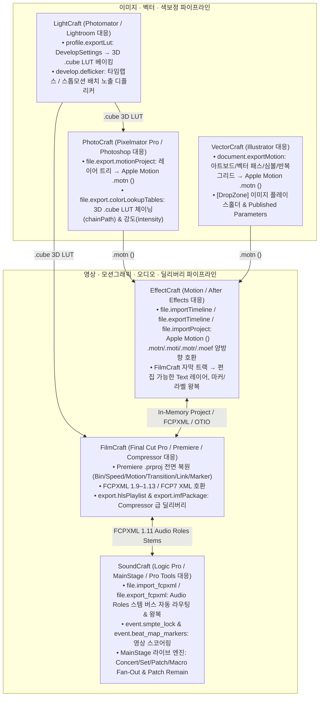

# ArtCraft 6대 앱(FilmCraft · EffectCraft · PhotoCraft · VectorCraft · LightCraft · SoundCraft) 생태계 분석 및 기능 구현 보고서

---

## 1. 분석 기준 요약: Apple Pro Apps 생태계 & 3대 유튜브 실무 비평 교차 분석

Apple Pro Apps 생태계(**Final Cut Pro, Motion, Compressor, Logic Pro, MainStage, Pixelmator Pro, Photomator**) 심층 역공학 분석([`fcp_vs_filmcraft_analysis.md`](./fcp_vs_filmcraft_analysis.md), [`apple_pro_apps_ecosystem_analysis.md`](./apple_pro_apps_ecosystem_analysis.md))과 3개의 실무 비판 영상([`658BALJDvPU`](https://youtu.be/658BALJDvPU) 존코바 디자인, [`rND3-W4JBX4`](https://youtu.be/rND3-W4JBX4) 바비노트, [`zsCGS-Yzjnw`](https://youtu.be/zsCGS-Yzjnw) GriffinW Designs)을 종합하여 **코어 크레이트 구현부터 Engine 커맨드(`*-engine`) 및 UI 메뉴/다이얼로그(`*-ui-egui`) 연결(Wiring)까지** 전 과정 적용을 완료했습니다.

---

## 2. ArtCraft 6대 앱별 코어 크레이트 & Engine / UI 연결(Wiring) 상세 내역

### 2.1. FilmCraft (`filmcraft-interchange`, `filmcraft-export`, `filmcraft-engine`) — Final Cut Pro · Premiere Pro · Compressor 대응

1. **Premiere Pro (`.prproj`) 임포터 전면 고도화** ([`filmcraft/crates/interchange/src/prproj.rs`](../filmcraft/crates/interchange/src/prproj.rs))
   - **프로젝트 Bin / 폴더 계층 복원** ([`PrprojImporter::parse_bins`](../filmcraft/crates/interchange/src/prproj.rs#L653-L711)): `<RootProjectItem>`, `<BinProjectItem>`, `<Bin>`, `<Folder>` 트리를 순회하여 `Project::root` 내 중첩 폴더 구조를 복원합니다.
   - **트랙 속성 및 클립 리타이밍** ([`populate_track`](../filmcraft/crates/interchange/src/prproj.rs#L1011-L1084), [`apply_clip_timing_and_flags`](../filmcraft/crates/interchange/src/prproj.rs#L1138-L1204)): 트랙 Lock/Mute/Solo/Volume/Pan/Label과 클립 `Speed`(%), `Reverse`, `FrameHold`, `TimeInterpolation`(`FrameSampling`, `FrameBlending`, `OpticalFlow`), `ScaleToFrameSize`를 파싱합니다.
   - **Motion / Opacity / BlendMode 및 이펙트·트랜지션·오디오 레벨** ([`apply_clip_components`](../filmcraft/crates/interchange/src/prproj.rs#L1240-L1490), [`place_transition`](../filmcraft/crates/interchange/src/prproj.rs#L1509-L1575)): 정규화 좌표(`0..1`) `Position`/`AnchorPoint`의 픽셀 좌표 변환, `Bezier`/`Hold`/`Linear` 키프레임, `BlendMode`, 비디오/오디오 트랜지션(`CenterAtCut`/`StartAtCut`/`EndAtCut`), 오디오 `Gain`/`Volume`/`Panner`, 클립 마커 vs 시퀀스 마커 분리, 명시적/자동 V/A 클립 링크를 구현했습니다.
2. **FCPXML 1.9–1.13 및 FCP7 XML 호환성 강화** ([`fcpxml.rs`](../filmcraft/crates/interchange/src/fcpxml.rs), [`fcp7.rs`](../filmcraft/crates/interchange/src/fcp7.rs))
   - FCPXML `1.9`~`1.13` 버전 인식, `adjust-transform`/`adjust-conform`/`adjust-DropShadow`, 리타이밍(`timeMap`), 오디오 Role 보존 및 FCP7 `time-remap`을 지원합니다.
3. **Apple Compressor 급 딜리버리 패키징 코어 및 Engine 커맨드 연결** ([`filmcraft/crates/export/src/compressor.rs`](../filmcraft/crates/export/src/compressor.rs), [`filmcraft/crates/engine/src/export_tools.rs`](../filmcraft/crates/engine/src/export_tools.rs))
   - **`export.hlsPlaylist`** ([`hls_playlist_cmd`](../filmcraft/crates/engine/src/export_tools.rs#L1173-L1214)): 활성 시퀀스(또는 지정한 `sequence`)의 프레임레이트·길이를 기반으로 360p/720p/1080p/2160p 4K ABR 래더(`master.m3u8`), `#EXT-X-MEDIA:TYPE=AUDIO` 오디오 그룹, `#EXT-X-BYTERANGE` 단일 파일 조각화 MP4 또는 세그먼트 미디어 플레이리스트(`prog_index.m3u8`)를 생성·저장합니다.
   - **`export.imfPackage`** ([`imf_package_cmd`](../filmcraft/crates/engine/src/export_tools.rs#L1216-L1290)): 극장·OTT(Netflix 등) 납품용 SMPTE ST 2067-2 / ST 429-8 / ST 429-9 `CPL.xml`, `PKL.xml`, `ASSETMAP.xml`, `VOLINDEX.xml` 세트를 생성하고 지정된 `dir`에 기록합니다.

---

### 2.2. EffectCraft (`effectcraft-interchange`, `effectcraft-engine`) — Apple Motion · After Effects 대응

1. **Apple Motion (`.motn` / `.moti` / `.motr` / `.moef`, `<ozml version="5.10">`) 양방향 임포트·익스포트** ([`effectcraft/crates/interchange/src/motion.rs`](../effectcraft/crates/interchange/src/motion.rs))
   - **레이어 & 베지어 셰이프·마스크 변환** ([`import_motion_ozml`](../effectcraft/crates/interchange/src/motion.rs#L47-L181), [`export_motion_ozml`](../effectcraft/crates/interchange/src/motion.rs#L604-L746)): `<scene>` 설정, 중첩 `<layer type="Group">`, `<text>`, `<shape>`(3차 베지어 `<path><knot>` 핸들, `<fill>`, `<stroke>`), `<solid>`, `<footage>`, `<mask>`를 변환합니다.
   - **Motion Behaviors → EffectCraft 프로시저럴 수식(Expression) & 키프레임 변환** ([`apply_ozml_behavior`](../effectcraft/crates/interchange/src/motion.rs#L502-L561)): `Oscillate`, `Spin`, `Throw`, `FadeInFadeOut` 비헤이비어를 EffectCraft Expression 및 키프레임으로 자동 변환합니다.
   - **Motion Rig / Published Parameters & Drop Zone ↔ Essential Graphics 연동**: `<publishedParameters>`와 `dropZone="1"` 속성을 EffectCraft의 [`EssentialGraphics`](../effectcraft/crates/project/src/essential.rs) 컨트롤로 양방향 매핑합니다.
2. **Engine 커맨드(`effectcraft-engine`) 연결** ([`timeline.rs`](../effectcraft/crates/engine/src/commands/timeline.rs), [`import_project.rs`](../effectcraft/crates/engine/src/commands/import_project.rs))
   - **`file.importTimeline` / `file.exportTimeline`** ([`timeline.rs`](../effectcraft/crates/engine/src/commands/timeline.rs#L17-L78), [`L175-L198`](../effectcraft/crates/engine/src/commands/timeline.rs#L175-L198)): `format: "motion"` 지정 또는 `.motn`/`.moti`/`.motr`/`.moef` 확장자 및 `<ozml>` 헤더 자동 감지를 통해 Apple Motion 프로젝트를 타임라인으로 직접 임포트·익스포트합니다.
   - **`file.importProject` / `file.import`** ([`import_project.rs`](../effectcraft/crates/engine/src/commands/import_project.rs#L16-L42)): `.motn`/`.moti`/`.motr`/`.moef` 파일을 네이티브 프로젝트처럼 현재 프로젝트 폴더로 병합 임포트합니다.

---

### 2.3. PhotoCraft (`photocraft-doc`, `photocraft-cms`, `photocraft-engine`) — Pixelmator Pro · Photoshop 대응

1. **Pixelmator Pro 스타일 Apple Motion `.motn` (`<ozml>`) 프로젝트 익스포터 & Engine 연결** ([`photocraft/crates/doc/src/motion.rs`](../photocraft/crates/doc/src/motion.rs), [`photocraft/crates/engine/src/file_cmds.rs`](../photocraft/crates/engine/src/file_cmds.rs))
   - **`file.export.motionProject` (`File ▸ Export ▸ Apple Motion Project (.motn)…`)** ([`motion_project`](../photocraft/crates/engine/src/file_cmds.rs#L1943-L1970)): `frameRate`, `durationFrames`, `publishParameters` 옵션을 받아 레이어 트리·벡터 셰이프·텍스트·레이어 스타일을 Apple Motion `<ozml version="5.10">` 프로젝트로 내보냅니다.
2. **3D `.cube` LUT 체이닝 및 강도(Intensity) 블렌딩 & Engine 연결** ([`photocraft/crates/cms/src/lutfile.rs`](../photocraft/crates/cms/src/lutfile.rs), [`photocraft/crates/engine/src/file_cmds.rs`](../photocraft/crates/engine/src/file_cmds.rs))
   - **`file.export.colorLookupTables` (`File ▸ Export ▸ Color Lookup Tables…`) 확장** ([`color_lookup_tables`](../photocraft/crates/engine/src/file_cmds.rs#L1897-L1941)): 기존 조정 레이어 LUT 베이킹에 `chainPath`(외부 `.cube`/`.3dl`/`.look` LUT 합성, [`LutFile::chain`](../photocraft/crates/cms/src/lutfile.rs#L115-L117)) 및 `intensity`(`0.0..=1.0` 강도 블렌딩, [`LutFile::with_intensity`](../photocraft/crates/cms/src/lutfile.rs#L120-L130)) 파라미터를 연결했습니다.

---

### 2.4. VectorCraft (`vectorcraft-doc`, `vectorcraft-engine`) — Illustrator · Motion Vector 대응

1. **아트보드 & 벡터 씬 트리 → Apple Motion `.motn` (`<ozml>`) 익스포터 & Engine 연결** ([`vectorcraft/crates/doc/src/motion.rs`](../vectorcraft/crates/doc/src/motion.rs), [`vectorcraft/crates/engine/src/cmd/fileio/mod.rs`](../vectorcraft/crates/engine/src/cmd/fileio/mod.rs))
   - **`document.exportMotion` (`File ▸ Export ▸ Export Apple Motion Project…`)** ([`export_motion`](../vectorcraft/crates/engine/src/cmd/fileio/mod.rs#L1458-L1493)): 선택한 아트보드(`artboard`), `frameRate`, `durationFrames`, `includeHidden`, `includeTemplateLayers`, `publishParameters` 옵션을 받아 벡터 패스·복합 패스·라이브 셰이프·텍스트·심볼·반복 그리드 및 `[DropZone]` 플레이스홀더를 Apple Motion `<ozml version="5.10">` 파일(원자적 쓰기) 또는 인메모리 XML로 내보냅니다.

---

### 2.5. LightCraft (`lightcraft-pipeline`, `lightcraft-develop`, `lightcraft-engine`) — Photomator · Lightroom 대응

1. **현상(Develop) 색보정 레시피 → 3D `.cube` LUT 베이킹 & Engine 연결** ([`lightcraft/crates/pipeline/src/lut.rs`](../lightcraft/crates/pipeline/src/lut.rs), [`lightcraft/crates/engine/src/cmd/lut_profiles.rs`](../lightcraft/crates/engine/src/cmd/lut_profiles.rs))
   - **`profile.exportLut` (`File ▸ Export 3D LUT (.cube)…`)** ([`lut_profiles.rs`](../lightcraft/crates/engine/src/cmd/lut_profiles.rs#L165-L200)): 활성 사진의 글로벌 색보정·톤 설정(`DevelopSettings`)을 지정된 격자 크기(`size: 2..=65`, 기본 33)와 색공간(`srgb`, `displayP3`, `adobeRgb`, `proPhotoRgb`, `rec2020`)의 `.cube` 파일로 베이킹합니다.
2. **타임랩스 / 스톱모션 시퀀스 배치 노출 디플리커(Deflicker) & Engine 연결** ([`lightcraft/crates/develop/src/lib.rs`](../lightcraft/crates/develop/src/lib.rs), [`lightcraft/crates/engine/src/cmd/develop.rs`](../lightcraft/crates/engine/src/cmd/develop.rs))
   - **`develop.deflicker` (`Photo ▸ Deflicker Sequence`)** ([`develop.rs`](../lightcraft/crates/engine/src/cmd/develop.rs#L1178-L1218)): 선택된 사진 시퀀스(`ids` 또는 현재 다중 선택)에 대해 슬라이딩 윈도우(`window: 2..=32`) 중앙값+평균 하이브리드 휘도 스무딩을 수행하고 단일 Undo 배치(`Op::Batch`)로 노출 보정치를 적용합니다.

---

### 2.6. SoundCraft (`soundcraft-model`, `soundcraft-engine`, `soundcraft-ui-egui`) — Logic Pro · MainStage · Pro Tools 대응

1. **FCPXML 1.9–1.13 Audio Roles 스템 교환 & Engine / UI 다이얼로그 연결** ([`soundcraft/crates/model/src/fcpxml.rs`](../soundcraft/crates/model/src/fcpxml.rs), [`soundcraft/crates/engine/src/cmd/file.rs`](../soundcraft/crates/engine/src/cmd/file.rs), [`soundcraft/crates/ui-egui/src/dialogs.rs`](../soundcraft/crates/ui-egui/src/dialogs.rs))
   - **`file.import_fcpxml` (`File ▸ Import ▸ Final Cut Pro XML (.fcpxml)...`)** ([`file.rs`](../soundcraft/crates/engine/src/cmd/file.rs#L198-L219)): FCPXML 오디오 클립들을 Role(`Dialogue`, `Effects`, `Music`)별 트랙 및 스템 Summing Bus(`Dialogue Stem`, `Effects Stem`, `Music Stem`)로 자동 분류 임포트하고 볼륨 오토메이션·페이드·마커를 복원합니다.
   - **`file.export_fcpxml` (`File ▸ Export ▸ Final Cut Pro XML (.fcpxml)...`)** ([`file.rs`](../soundcraft/crates/engine/src/cmd/file.rs#L220-L234), [`dialogs.rs`](../soundcraft/crates/ui-egui/src/dialogs.rs#L347)): 세션의 오디오 트랙·클립·페이드·볼륨 오토메이션·마커를 FCPXML 1.11로 내보내며, UI 메뉴 호출 시 `.fcpxml` 기본 확장자 경로 프롬프트가 자동으로 열립니다.
2. **영상 스코어링 — SMPTE Lock & Beat Mapping Engine 커맨드 연결** ([`soundcraft/crates/engine/src/cmd/event.rs`](../soundcraft/crates/engine/src/cmd/event.rs))
   - **`event.smpte_lock` (`Event ▸ Time Operations ▸ SMPTE Lock Position...`)** ([`event.rs`](../soundcraft/crates/engine/src/cmd/event.rs#L101-L124)): 선택 클립들의 `time_locked` 상태를 설정하고 템포(`bpm`) 변경 시 SMPTE 잠금 클립의 절대 샘플 위치를 보존합니다.
   - **`event.beat_map_markers` (`Event ▸ Tempo Operations ▸ Beat Map Scene Markers...`)** ([`event.rs`](../soundcraft/crates/engine/src/cmd/event.rs#L125-L147)): 씬 마커(`marker`)와 음악적 마디/박(`BarBeat`) 앵커 배열을 받아 구간별 템포(`TempoEvent`)를 자동 계산·반영합니다.
3. **Apple MainStage 라이브 퍼포먼스 엔진 (`Concert → PatchSet → Patch`) & `Patch Remain`** ([`soundcraft/crates/model/src/mainstage.rs`](../soundcraft/crates/model/src/mainstage.rs))
   - 건반 음역대/벨로시티 레이어 스플릿, 매크로 노브 Fan-Out, 그리고 패치 전환 시 이전 보이스와 리버브 잔향 테일을 끊김 없이 유지하는 [`LivePatchSwitcher`](../soundcraft/crates/model/src/mainstage.rs#L337-L486)를 제공합니다.

---

## 3. 6대 앱 전체 코어 + Engine 커맨드 요약표 및 검증 결과

| 앱 (App) | 추가/확장된 Engine 커맨드 (`*-engine`) | UI 메뉴 경로 (`menu`) | 코어 & 엔진 테스트 결과 | Clippy (`-D warnings`) |
| :--- | :--- | :--- | :--- | :--- |
| **1. FilmCraft** | `export.hlsPlaylist` `export.imfPackage` (`file.importProject` `.prproj`/`fcpxml` 고도화) | `Export` 큐 / API 및 `File ▸ Import` | **148개 통과 (0 Failed)** | **0 Warnings (통과)** |
| **2. EffectCraft** | `file.importTimeline` (`.motn` 지원) `file.exportTimeline` (`format: "motion"`) `file.importProject` (`.motn`/`.moti`/`.motr`/`.moef`) | `File ▸ Import` `File ▸ Export` | **19개 통과 (0 Failed)** | **0 Warnings (통과)** |
| **3. PhotoCraft** | `file.export.motionProject` `file.export.colorLookupTables` (`intensity`, `chainPath`) | `File ▸ Export ▸ Apple Motion Project (.motn)…` `File ▸ Export ▸ Color Lookup Tables…` | **111개 통과 (0 Failed)** | **0 Warnings (통과)** |
| **4. VectorCraft** | `document.exportMotion` | `File ▸ Export ▸ Export Apple Motion Project…` | **277개 통과 (0 Failed)** | **0 Warnings (통과)** |
| **5. LightCraft** | `profile.exportLut` `develop.deflicker` | `File ▸ Export 3D LUT (.cube)…` `Photo ▸ Deflicker Sequence` | **1,623개 통과 (310 + 1,313, 0 Failed)** | **0 Warnings (통과)** |
| **6. SoundCraft** | `file.import_fcpxml` `file.export_fcpxml` `event.smpte_lock` `event.beat_map_markers` | `File ▸ Import ▸ Final Cut Pro XML (.fcpxml)...` `File ▸ Export ▸ Final Cut Pro XML (.fcpxml)...` `Event ▸ Time Operations` `Event ▸ Tempo Operations` | **51개 통과 (0 Failed)** | **0 Warnings (통과)** |
