# Blackmagic Design DaVinci Resolve 21.2.0.6 전 계층 역공학 아키텍처 · 플러그인 생태계 · UI/UX 및 FilmCraft 기능 구현 보고서

본 문서는 `reverse-engineer-anything` (`REA v6.10.1`, skill `v63`) 및 `ghidra-hopper-rs` (`v0.3.1`)를 사용하여 로컬 시스템(`C:\ProgramData\Microsoft\Windows\Start Menu\Programs\Blackmagic Design\DaVinci Resolve` $\rightarrow$ `C:\Program Files\Blackmagic Design\DaVinci Resolve` 및 `C:\ProgramData\Blackmagic Design\DaVinci Resolve\Support`)에 설치된 **DaVinci Resolve `21.2.0.6`** 의 실제 바이너리 아티팩트, PE32+ 섹션·임포트/익스포트 테이블, 10대 플러그인 SDK 인터페이스, 그리고 7-Page 통합 워크스페이스 UI/UX를 정밀 분석하고, 이를 바탕으로 **[FilmCraft](../filmcraft)** (`v0.20.1`)에 누락되어 있던 **플러그인 아키텍처(DCTL · OpenFX · Fairlight/VST3 · OGraf · Workflow)** 와 **DaVinci Resolve 급 색보정·오디오·UI/UX 기능**을 클린룸(Clean-Room) 순수 Rust로 설계·구현한 종합 기술 문서입니다.

---

## 1. REA 정적 증거 원장 (Shipped-Artifact Evidence Ledger)

사용자 시작 메뉴 경로(`C:\ProgramData\Microsoft\Windows\Start Menu\Programs\Blackmagic Design\DaVinci Resolve`)의 5개 Windows Shell Link(`.lnk`)로부터 실제 실행 타겟과 컴포넌트 그래프를 비실행(Non-Execution) 정적 분석으로 추적했습니다.

### 1.1 Windows Start Menu Shell Link (`.lnk`) 해부 (`inspect_windows_shortcut`)

| 바로가기 파일 (`.lnk`) | SHA-256 (앞 16자) | REA Evidence ID | 실제 타겟 바이너리 경로 및 실행 인자 | 아키텍처적 발견 사항 |
| :--- | :--- | :--- | :--- | :--- |
| **`DaVinci Resolve.lnk`** | `62876ea89f6591d5` | `ev_4d67b96ef21f...` | `C:\Program Files\Blackmagic Design\DaVinci Resolve\Resolve.exe` (인자 없음) | 메인 통합 NLE · VFX · 색보정 · 오디오 마스터링 호스트 (`MSI {F3BA05F0-7356-4DDA-AF32-5A8AE8CC9960}`) |
| **`Blackmagic Proxy Generator.lnk`** | `a381edbe5ff41036` | `ev_67c74ec074c4...` | `C:\Program Files\Blackmagic Design\DaVinci Resolve\Resolve.exe -pg` | **단일 바이너리 멀티 페르소나(Multi-Persona) 설계**: 별도 실행 파일이 아닌 `Resolve.exe`에 `-pg` 플래그를 전달해 경량 감시 폴더 프록시 트랜스코더 UI로 기동 |
| **`Blackmagic Remote Monitor.lnk`** | `e0bb97e03d4576de` | `ev_d253321857f9...` | `C:\Program Files\Blackmagic Design\DaVinci Resolve\Blackmagic Remote Monitor.exe` | WebRTC/저지연 하드웨어 코덱 기반 원격 레퍼런스 모니터링 클라이언트 (`v21.1.0`, `205.29 MB`) |
| **`DaVinci Control Panels.lnk`** | `9eef96241a70f69d` | `ev_fb6ef77c362e...` | `C:\Program Files (x86)\Blackmagic Design\DaVinci Control Panels\Setup Utility\DaVinci Control Panels Setup.exe` | USB/Ethernet 하드웨어 컬러 패널(Micro/Mini/Advanced Panel, Speed Editor) 펌웨어 및 매핑 데몬 (`2.28 MB`) |
| **`Fairlight Studio Utility.lnk`** | `c70f2329cc08e8e3` | `ev_41fed9aa83aa...` | `C:\Program Files (x86)\Blackmagic Design\DaVinci Control Panels\Fairlight Studio Utility\Fairlight Studio Utility.exe` | Fairlight 콘솔·오디오 인터페이스 MADI/Dante/iCan 하드웨어 라우팅 유틸리티 (`11.66 MB`) |

### 1.2 설치 디렉터리 및 핵심 PE32+ 모듈 정밀 인벤토리 (`inspect_desktop_application`, `inspect_native_exports`, `inspect_pe_imports`, `inspect_binary_hardening`)

- **루트 스냅샷 (`C:\Program Files\Blackmagic Design\DaVinci Resolve`)**: 총 **3,934개 엔트리** (`snapshot_sha256: 30acb1237a229eb12f7707c5b19a5c908cb74df1af8474f9a88ea0e86f290c0c`, `ev_e3ac3cda7fa3...`).
- **`Resolve.exe` (`v21.2.0.6`, `615,293,912` bytes = `586.79 MiB`, `x86_64` PE32+, `Subsystem=GUI`, `DllCharacteristics=0x8160` High-Entropy ASLR + NX + Terminal Server Aware)**:
  - `.text` (`128,310,238` bytes): 코어 C++17/20 애플리케이션, 타임라인·노드 그래프·컬러 파이프라인 엔진
  - `.rdata` (`324,846,898` bytes): Qt 리소스 트리, 내장 셰이더/LUT/UI 스킨 에셋, RTTI/Boost 직렬화 메타데이터
  - **`.nv_fatb` (`152,405,072` bytes = `145.34 MiB`)**: **DVIP(DaVinci Image Processing)** 전용 사전 컴파일 CUDA Fatbinary 커널 아카이브! `Resolve.exe` 단일 실행 파일 용량의 약 25%가 순수 GPU 이미지 처리 커널로 구성되어 있음이 확인됨
  - `.pdata` (`4,525,632` bytes): 약 37만 개 이상의 x64 구조적 예외/언와인드 함수 엔트리(`RUNTIME_FUNCTION`)
  - **PE Exports (`1,095`개 심볼)** 및 **PE Imports (`151`개 DLL)**

| 핵심 바이너리 / 플러그인 브리지 | 크기 | SHA-256 (앞 16자) | PE Exports | 아키텍처 역할 및 핵심 심볼 |
| :--- | ---: | :--- | ---: | :--- |
| **`Resolve.exe`** (`21.2.0.6`) | `615.29 MB` | *(PE64 Direct)* | `1,095` | `DVIP::AdvancedKeyerParams`, `DVIP::ColorGradientParams`, `CurvePointWarp`, `MatchMove::Trackpoint`, `DeadPixelPatch`, `InpaintPatch`, `FaceAnalysisParams` |
| **`fusionsystem.dll`** (`21.2`) | `37.64 MB` | `c91629a33b5fad85` | **`24,638`** | Fusion Studio 노드 합성 커널 전체 내장(2D/3D 씬 그래프, 파티클, USD/Alembic/FBX, 스크립팅 오퍼레이터) |
| **`FusionPage.dll`** | `12.38 MB` | `37a1e54b41c86fe0` | `1` | `QueryInterface` 단일 COM-스타일 팩토리로 `Resolve.exe` 호스트에 Fusion 페이지 뷰포트를 브리지 |
| **`FairlightPage.dll`** (`21.2.0.3`) | `33.31 MB` | `ff54c0cf757fdaf0` | `125` | 고정소수점/부동소수점 저지연 오디오 버스 엔진, ADR, Automation, Loudness, Dolby Atmos 통합 페이지 (`HIGH_ENTROPY_VA`, `NX_COMPAT`, `CFG_INSTRUMENTED`, Authenticode 서명 확인) |
| **`BMDAudioPlugins.dll`** (`21.2.0.3`) | `9.54 MB` | *(REA Complete)* | 다수 | 내장 Fairlight FX 플러그인 묶음(Dialogue Leveler, Vocal Channel, De-Esser, De-Hummer, Surround Analyzer 등) |
| **`DolbyAtmosBridge.dll` / `ImmersiveAudioBridge.dll`** | `16.19 MB` / `10.77 MB` | *(Shipped PE64)* | 다수 | 7.1.4 / 9.1.6 객체 기반 몰입형 오디오 렌더링 및 ADM BWF 마스터링 브리지 |
| **`Plugins\openfx.plugin`** | `346.5 KB` | `0d6b2c88b8d71eb5` | `0` (Host Adapter) | 외부 `C:\Program Files\Common Files\OFX\Plugins\*.ofx.bundle` 플러그인을 Fusion 및 Edit/Color 파이프라인으로 연결하는 호스트 로더 |
| **`Plugins\fuses.plugin`** | `160.7 KB` | `0f3b008b6ce60382` | `29` | LuaJIT FFI 기반 스크립트 노드 엔진 (`ffi_FuseState_FuRegisterClass`, `ScriptViewShaderAddControlPage`, `ScriptOperatorLockSharedData`) |
| **`Plugins\ograf.plugin` + `ograf-cef-host.exe`** | `1.22 MB` | `cddf9a906a8a5688` | `1` | **DaVinci Resolve 21 신기능**: EBU **OGraf** 표준 웹 방송 그래픽(`.ograf.json` + Web Component `goToTime()`)을 CEF 오프스크린 렌더러로 프레임 단위 합성 |

---

## 2. DaVinci Resolve 21.2 내부 서브시스템 심층 해부

```mermaid
flowchart TB
    subgraph UI["BMDDavUI + Qt5 Single-Window 7-Page Shell"]
        PageBar["하단 고정 7-Page Navigation Bar<br/>Media · Cut · Edit · Fusion · Color · Fairlight · Deliver"]
        MediaP["Media Page<br/>Clone Tool (XXH64/SHA256), Smart Bins, Power Bins, Metadata"]
        CutP["Cut Page<br/>Dual Timeline (Full Overview + Zoomed Track), Source Tape, Dynamic Zoom"]
        EditP["Edit Page<br/>Track/Trim NLE, Inspector, Effects Library, Take Selector, AI Text-Based Edit"]
        FusionP["Fusion Page (FusionPage.dll + fusionsystem.dll)<br/>DAG Node Compositor, 3D/USD, Planar/Camera Tracker"]
        ColorP["Color Page<br/>Serial/Parallel/Layer Node Graph (Graphviz cgraph), Wheels, Curves, Color Warper, Qualifier, Gallery Stills"]
        FairlightP["Fairlight Page (FairlightPage.dll)<br/>Subframe DAW, Bus/VCA Console, Dialogue Leveler, Dolby Atmos 9.1.6"]
        DeliverP["Deliver Page<br/>Render Queue, IMF/DCP (Kakadu/OpenJPH/easyDCP), Custom IO Encode Plugins"]
    end

    subgraph Engine["Core Media · Color · AI Engine (Resolve.exe)"]
        DVIP["DVIP 32-bit Float Pipeline (.nv_fatb 145 MiB CUDA + OpenCL/Metal/Vulkan)<br/>DaVinci Wide Gamut / Intermediate + OCIO 2.5 + Dolby Vision (dvdpk.dll)"]
        Neural["5-Backend DaVinci AI Neural Engine<br/>TensorRT 10 · DirectML · OpenVINO 2026.4 · ONNX Runtime · Local Multimodal LLM (llama.dll + mtmd.dll)"]
        DB["Project Library Engine (Qt5Sql)<br/>Local Disk SQLite + Multi-User PostgreSQL (LIBPQ.dll) + Blackmagic Cloud (davcloudclient.dll)"]
    end

    subgraph Plugins["10-Pillar Extensibility & Plugin Architecture"]
        OFX["1. OpenFX 1.4 Host<br/>(*.ofx.bundle: Filter / Transition / Generator / Temporal)"]
        DCTL["2. DaVinciCTL (.dctl)<br/>DEFINE_UI_PARAMS + GPU Pixel/Transition Shaders"]
        FUSE["3. Fusion Fuses (.fuse)<br/>LuaJIT FFI Procedural Nodes"]
        DRFX["4. Macro Bundles (.drfx / .setting)<br/>Edit Titles, Transitions, Effects, Generators"]
        VST["5. Audio Plugins (VST3 / AU / FairlightFX)"]
        DVCP["6. IO Codec Plugins (*.dvcp.bundle)<br/>Custom Container & Video/Audio Encoders"]
        OGRAF["7. EBU OGraf HTML5 Broadcast Graphics (*.ograf)"]
        WFI["8. Workflow Integrations (Electron Sandboxed IPC + UIManager)"]
        SCRIPT["9. Scripting API (fusionscript.dll: Python / Lua Headless & Live IPC)"]
        LUT_SYS["10. 1D/3D LUT & ACES LMT (.cube / .3dl / .ilut / .olut / .xml)"]
    end

    PageBar --> MediaP & CutP & EditP & FusionP & ColorP & FairlightP & DeliverP
    MediaP & CutP & EditP & FusionP & ColorP & FairlightP & DeliverP --> DVIP & Neural & DB
    DVIP <--> OFX & DCTL & FUSE & DRFX & OGRAF & LUT_SYS
    FairlightP <--> VST
    DeliverP <--> DVCP
    DB <--> WFI & SCRIPT
```

### 2.1 핵심 발견 1: 5중 백엔드 AI Neural Engine + 온디바이스 멀티모달 LLM (`llama.dll` + `mtmd.dll`)
`Resolve.exe`의 PE Import 테이블에서 기존 `TensorRT 10`(`nvinfer_10.dll`), `DirectML`(`DirectML.dll`), `OpenVINO 2026.4`(`openvino.dll`), `ONNX Runtime`(`onnxruntime.dll`), `NVIDIA NGX VSR`(`nvngx_vsr.dll`)뿐 아니라 **`llama.dll`, `mtmd.dll`, `ggml-base.dll`, `ggml-cuda.dll`** 이 직접 링크되어 있음이 확인되었습니다.
- 이는 DaVinci Resolve 21.2가 클라우드 의존 없이 로컬 GPU에서 멀티모달 LLM/VLM을 구동하여 대본 기반 타임라인 자동 조립(**AI IntelliScript**), 멀티캠 화자·구도 자동 스위칭(**AI SmartSwitch**), 대사 톤 매칭(**AI Dialogue Matcher**), 자연어 미디어 검색을 처리함을 입증합니다.

### 2.2 핵심 발견 2: 수학적 솔버 기반 색보정·트래킹 (`ceres.dll` + `cgraph.dll` + `OpenColorIO_2_5.dll`)
- **Color Warper (`CurvePointWarp`) & 3D Tracker**: Google **Ceres Solver**(`ceres.dll`) 비선형 최소자승법 최적화기를 내장하여, Color Warper의 거미줄(Spider-web) 격자에서 사용자가 특정 색상 핀 하나를 당길 때 주변 고정 핀들의 연속 미분 제약을 풀고 부드러운 색공간 변형 필드를 실시간 계산합니다.
- **Node Graph Auto-Layout (`cgraph.dll`, `gvc.dll`)**: Color 페이지와 Fusion 페이지의 `Clean Up Node Graph` 기능이 **Graphviz** C 라이브러리의 계층형 DAG 레이아웃 알고리즘으로 구동됩니다.
- **Scene-Referred Wide Gamut (`DaVinci Wide Gamut / Intermediate` + `OCIO 2.5`)**: 모든 카메라 Log(`ARRI LogC3/4`, `RED Log3G10`, `Sony S-Log3`, `Blackmagic Film Gen 5/6`)를 광대역 중간 색공간으로 먼저 변환(CST Input)한 뒤, 모든 그레이딩·할레이션(Halation)·블러를 선형/로그 공간에서 수행하고 마지막 출력 노드(CST Output)에서 `Rec.709` 또는 `Rec.2100 PQ/HLG`로 톤매핑/개멋 압축합니다.

---

## 3. DaVinci Resolve의 10대 플러그인 아키텍처 해부 (`Support\Developer\`)

사용자 요청의 핵심인 **플러그인 기능**을 위해, DaVinci Resolve가 서드파티 생태계를 확장하는 모든 플러그인 계층을 SDK 명세 수준까지 분석했습니다.

| 플러그인 규격 | 패키지 / 확장자 | 진입점 · 매니페스트 규격 | GPU / 멀티스레드 모델 | 적용 위치 |
| :--- | :--- | :--- | :--- | :--- |
| **1. OpenFX (`v1.4`)** | `*.ofx.bundle/Contents/{Win64,Win-arm64ec,MacOS,Linux-x86-64}/*.ofx` | `OfxGetNumberOfPlugins`, `OfxGetPlugin`, `OfxSetHost`; 컨텍스트: `eContextFilter`, `eContextTransition`, `eContextGeneral` | `processImagesCUDA` (`cudaStream`), `processImagesMetal`, `processImagesOpenCL`, `multiThreadProcessImages`; `getFramesNeeded()` 시간축 프레임 접근 + `setNoSpatialAwareness(true)` LUT 베이킹 허용 | Edit 클립/트랜지션, Color 노드, Fusion 노드 |
| **2. DaVinciCTL (`DCTL`)** | `*.dctl` (평문) / `*.dctle` (만료일 암호화) | `DEFINE_UI_PARAMS(id, label, DCTLUI_SLIDER_FLOAT \| SLIDER_INT \| CHECK_BOX \| COMBO_BOX \| COLOR_PICKER, ...)`, `__DEVICE__ float3/float4 transform(...)`, `__DEVICE__ float4 transition(...)` | NVRTC / Metal / OpenCL 런타임 JIT 컴파일; `_tex2D` 공간 텍스처 샘플링, `DEFINE_CUBE_LUT` + `APPLY_LUT`, `TRANSITION_PROGRESS`, `TIMELINE_FRAME_INDEX` 내장 | Color 노드 LUT, ResolveFX DCTL 이펙트, Edit DCTL 트랜지션 |
| **3. Fusion Fuse** | `*.fuse` | `FuRegisterClass(name, CT_Tool \| CT_SourceTool \| CT_Modifier, {...})`, `Create()`, `Process(req)` | LuaJIT FFI(`fuses.plugin`) + 내장 DCTL GPU 커널(`ScriptViewShader`) | Fusion 합성 그래프 및 Edit 템플릿 |
| **4. ResolveFX Macro Bundle** | `*.drfx` (ZIP 컨테이너) / `*.setting` | `Edit/{Titles,Transitions,Generators,Effects}/` 디렉터리 계층 그대로 압축 | 호스트 네이티브 노드 그래프 즉시 인스턴스화 | Edit Effects Library 전 카테고리 |
| **5. Audio Plugins** | `*.vst3`, `*.component`(AU), 내장 `FairlightFX` | Steinberg VST3 IAudioProcessor / IEditController + Fairlight 네이티브 DSP 버스 | 선행 프리롤(Pre-roll) 및 Look-ahead 레이턴시 자동 보정(`AudioEffect` 체인) | 클립 인서트, 트랙 인서트(6슬롯), Submix/Main 버스 |
| **6. IO Codec Plugin** | `*.dvcp.bundle/Contents/{Win64,MacOS,Linux-x86-64}/*.dvcp` | C++ 래퍼 호스트 등록(커스텀 컨테이너·비디오/오디오 인코더 파라미터 노출) | CPU 프레임/오디오 패킷 스트림 풀링 | Deliver 페이지 Format / Codec 목록 |
| **7. EBU OGraf Graphics** | `*.ograf.json` + HTML Web Component (`.ograf` / `.drfx`) | JSON Schema 프로퍼티 선언 + `"supportsNonRealTime": true` + `goToTime()` 결정론적 프레임 시킹 | macOS `WKWebView` / Windows `CEF`(`ograf-cef-host.exe`) 오프스크린 프레임 캡처 | Edit 페이지 Titles ▸ OGraf |
| **8. Workflow Integrations** | `com.<org>.<name>/manifest.xml` + `main.js` / `.py` / `.lua` | `WorkflowIntegration.Initialize(id)` $\rightarrow$ `GetResolve()` / `GetResolvePromise()`; 콜백 `RenderStart`, `RenderStop`, `ResolveQuit` | Electron Context-Isolated Sandbox 또는 내장 `UIManager` / `UIDispatcher` 위젯 루프 | `Workspace ▸ Workflow Integrations` 도킹/모달 창 |
| **9. Scripting API** | `.py` / `.lua` (`DaVinciResolveScript.pyi` 3,645라인) | `ProjectManager`, `Project`, `MediaPool`, `Folder`, `MediaPoolItem`, `Timeline`, `TimelineItem`, `Gallery`, `ColorGroup` | 로컬 소켓/파이프 IPC(`fusionscript.dll`), 헤드리스 배치 자동화 지원 | Console, 외부 CI/파이프라인, MCP |
| **10. LUT & ACES LMT** | `.cube`, `.3dl`, `.ilut`, `.olut`, `.dat`, `.xml` | 1D Shaper(Linear 보간) + 3D Lattice(Trilinear / **Tetrahedral 사면체 보간**) | 3D 텍스처 하드웨어 보간 및 DCTL 인라인 결합 | Media Input LUT, Color Node, Monitor Calibration, Deliver |

---

## 4. DaVinci Resolve vs. FilmCraft (`v0.20.1`) 기능 격차 및 UI/UX 벤치마크 진단

### 4.1 기존 FilmCraft (`v0.20.1`)의 강점과 한계 진단
- **이미 잘 구현된 기반**:
  - 64-bit 정확한 시간축(`Tick = 254,016,000,000/s`), 32-bit 선형 부동소수점 합성(`filmcraft-render`), `Rec.709` / `Rec.2100 PQ` / `Rec.2100 HLG` 작업 색공간, 하드웨어 디코딩/인코딩(`VideoToolbox`, `Media Foundation`, `NVENC`), Whisper 음성인식 자막/텍스트 편집, Kokoro TTS, AAF/OMF/FCPXML/OTIO/EDL 호환, 5.1 서라운드/R128 라우드니스 미터, 모든 조작의 `Session::execute` 커맨드화 및 MCP/Control 서버 지원.
- **DaVinci Resolve 대비 결정적 누락 기능 (Gap)**:
  1. **플러그인 시스템 부재 (`Settings ▸ Plugins`가 스텁 상태)**:
     - [`crates/engine/src/settings/schema.rs`](../filmcraft/crates/engine/src/settings/schema.rs)에 `"No plugins are installed."` 안내문만 존재하고, 실제 플러그인 레지스트리·폴더 스캐너·활성/비활성 관리·커스텀 셰이더/플러그인 실행 엔진이 전혀 없었음.
  2. **DCTL (DaVinci Color Transform Language) 커스텀 픽셀/트랜지션 셰이더 부재**:
     - 컬러스트와 플러그인 개발자들이 가장 널리 쓰는 `.dctl` 스크립트(`DEFINE_UI_PARAMS` + `transform()`)를 로드·검증·실행할 수 없었음.
  3. **DaVinci Resolve 핵심 영상/색보정/오디오 이펙트 부재**:
     - **Color Space Transform (CST)**: 카메라 Log(`ARRI LogC3/4`, `Sony S-Log3`, `RED Log3G10`, `BMD Film Gen 5`, `ACEScct`, `DaVinci Wide Gamut`) 간 정밀 색역·전달함수 변환 및 톤매핑 플러그인 부재.
     - **Film Halation**: 필름 에멀전 적색광 산란 물리 모델 이펙트 부재.
     - **Color Warper**: 특정 색상·채도 영역만 거미줄 격자처럼 비틀고 주변 색상은 고정(Pin)하는 직관적 워핑 도구 부재.
     - **3D Qualifier (Inside / Outside 분리 보정)**: 단일 이펙트 안에서 키잉 내부(피부톤 등)와 외부(배경 디포커스/쿨톤화)를 동시에 분리 그레이딩하는 도구 부재.
     - **Dynamic Zoom**: 키프레임 수동 입력 없이 시작/끝 프레이밍과 Ease 곡선만으로 즉시 Ken Burns 줌인/줌아웃을 만드는 Cut/Edit 페이지 필수 기능 부재.
     - **Fairlight Dialogue Leveler**: 단순 컴프레서를 넘어 속삭임 증폭·배경소음 보호(Gate Hold)를 수행하는 방송용 실시간 대사 레벨 라이더 부재.
     - **Gallery Stills & PowerGrades**: 현재 프레임의 색보정/플러그인 체인을 스틸 슬롯으로 캡처(`Grab Still`)하고 다른 클립/시퀀스에 원클릭으로 복제 적용하는 갤러리 시스템 부재.
  4. **UI/UX 개선 포인트 (DaVinci Resolve 기준)**:
     - 기존 상단 헤더는 Premiere 스타일의 `Import | Edit | Export` 3탭만 제공하여, 편집 도중 **Cut · Fusion(VFX/Plugins) · Color · Fairlight(Audio)** 전문 작업 환경으로 전환하려면 상단 우측의 작은 드롭다운 메뉴를 여러 번 클릭해야 했음.
     - **DaVinci Resolve 하단 7-Page Navigation Bar (`Media · Cut · Edit · Fusion · Color · Fairlight · Deliver`)** 를 하단 바에 도입하면 원클릭으로 모드와 최적 도킹 레이아웃이 즉시 전환되어 작업 동선이 획기적으로 단축됨.
     - **Cut Page Dual-Timeline (상단 전체 시퀀스 조감도 스트립 + 하단 정밀 타임라인)**: 긴 호흡의 타임라인에서 줌인/줌아웃 반복 없이 상단 Overview 바 클릭/드래그만으로 즉시 전체 구성을 조망하고 이동할 수 있음.
     - **Color Grading 패널 상단 Serial Node Bar & PowerGrades 스트립**: 클립에 적용된 다중 컬러/플러그인 노드를 `01 CST → 02 Grade → 03 Halation → 04 DCTL` 파이프라인 칩으로 한눈에 보고 선택·추가·바이패스할 수 있는 UX.
     - **전용 `Plugins` 도킹 패널 (Plugin Hub & DCTL Studio)**: 설치/내장된 OpenFX · DCTL · Fairlight · OGraf · Workflow 플러그인을 카테고리별로 검색·적용하고, `.dctl` 코드를 앱 안에서 직접 작성·문법 검증·즉시 적용할 수 있는 통합 스튜디오 패널.

---

## 5. FilmCraft 신규 구현 아키텍처 상세

FilmCraft의 엄격한 엔지니어링 규칙(`unsafe_code = "forbid"`, 프로덕션 `unwrap`/`panic` 전면 금지, `wasm32` 웹 빌드 100% 호환, L0 $\rightarrow$ L6 단방향 레이어링)을 완벽히 준수하여 다음과 같이 구현했습니다.

| 계층 | 모듈 / 파일 | 구현 내용 요약 |
| :--- | :--- | :--- |
| **L1 (`filmcraft-project`)** | `crates/project/src/plugin.rs`, `substance3d.rs`, `effect.rs`, `effect/vfx.rs`, `vtransition.rs`, `lib.rs` | `PluginKind`, `ProjectPlugin`(`enabled` 포함), `PowerGradeStill`, **공식 Resolve DCTL SDK 호환 순수 Rust DCTL 파서 및 AST 평가기**(`DEFINE_UI_PARAMS` 5종 컨트롤, `DEFINE_CUBE_LUT`/`DEFINE_LUT` + **6-사면체(Tetrahedral)·삼선형 3D `.cube` LUT 보간** `APPLY_LUT`, 사용자 정의 `__DEVICE__` 헬퍼 함수, 공간 `_tex2D`, `builtin_transition_dctls`), 안전 `.obj` 메시 파서(`ObjMesh`), 신규 비디오/오디오 이펙트(`dctl_transform`, `color_space_transform`, `film_halation`, `color_warper`, `qualifier_3d`, `dynamic_zoom`, `stage_3d`, `surface_relight`, `procedural_pbr`, `dialogue_leveler`) 및 **`dctl_transition` 비디오 트랜지션** 정의 |
| **L1 (`filmcraft-audio-dsp`)** | `crates/audio-dsp/src/effects/fairlight.rs`, `effects.rs`, `lib.rs` | **Fairlight Dialogue Leveler** (`DialogueLeveler`) 듀얼 윈도우(Fast 80 ms / Slow 650 ms) RMS 엔벨로프 팔로워 + 노이즈 플로어 보호 게이트 홀드 + 소프트 클리퍼 실시간 오디오 DSP 구현 |
| **L3 (`filmcraft-render` & `filmcraft-gpu`)** | `crates/render/src/resolve_fx.rs`, `stage3d.rs`, `gpufx.rs`, `transitions/special.rs`, `crates/gpu/src/fx.rs`, `fx.wgsl` | `dctl_transform` & `dctl_transition` 멀티스레드(`rayon`) 셰이더 실행기, **ResolveFX 4종(`CST`, `ColorWarper`, `Qualifier3d`, `DynamicZoom`) `wgpu` WGSL / DX12 FXC 컴퓨트 셰이더 가속(`Rgba32Float`, CPU/GPU 동등성 검증 완료)**, SMPTE RP 177 CIE 1931 양방향 색역 변환, `film_halation`, 그리고 **Substance 3D 급 `stage_3d`(SDF Clay + `.obj` AABB BVH 레이캐스터 + Cook-Torrance GGX + Video-Driven IBL + Shadow Catcher) · `surface_relight`(Retinex/Scharr 6채널 PBR 추출 & 심리스 타일링) · `procedural_pbr`** 구현 |
| **L4 (`filmcraft-engine`)** | `crates/engine/src/plugins.rs`, `drfx_zip.rs`, `substance3d.rs`, `resolve_workflows.rs`, `resolve_ai.rs`, `commands.rs` | 플러그인 폴더 스캐너 + **순수 Rust 16 MiB 상한 `.drfx`(ZIP/DEFLATE) 번들 임포터(`plugins.importDrfx`) & EBU `.ograf.json` 방송 그래픽 타이틀 생성기(`plugins.importOgraf`)**, Cut/Media 워크플로(**`cut.sourceTape` / `cut.sourceTapeSeek` / `cut.fastReview` / `media.cloneVerify`(FIPS 180-4 SHA-256 검증) / `project.smartBin`**), **DaVinci Resolve 21 AI 3종(`ai.intelliScript` 순서 보존 DP 대본 러프컷 조립, `multicam.smartSwitch` 앵글별 RMS 오디오 자동 스위칭, `audio.matchDialogue` 3대역 RBJ 바이쿼드 스펙트럼·라우드니스 매칭)**, Substance 3D 프리셋/PBR 추출(`stage3d.applyPreset`, `material.sampleClipPbr`) |
| **L5 (`filmcraft-ui-egui`)** | `page_bar.rs`, `panels/plugins_panel.rs`, `panels/lumetri.rs`, `panels/effect_controls.rs`, `panels/timeline.rs`, `panels/settings.rs`, `i18n/` | ① **하단 상태바 인라인 7-Page Navigation Bar (`Media · Cut · Edit · Fusion · Color · Fairlight · Deliver` + `Plugins`)**, ② **`Cut` 듀얼 타임라인 Full-Sequence Overview Strip (`timeline.cutOverview`)**, ③ **Color Grading 패널 `Color Nodes & PowerGrades` + 인터랙티브 `Color Warper` 거미줄(Spider-Web) 캔버스 위젯 (`lumetri.colorWarper.canvas`)**, ④ **Effect Controls 패널 동적 DCTL `DEFINE_UI_PARAMS` 위젯 렌더링**, ⑤ **`Plugins` 패널 (`3D & Material Lab` + `.drfx`/`.ograf` 원클릭 적용 + Live DCTL Studio)** 및 한국어(`ko.tsv`)·스페인어(`es.tsv`) 번역 완비 |
