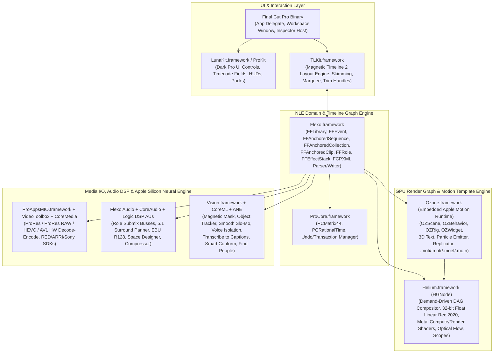
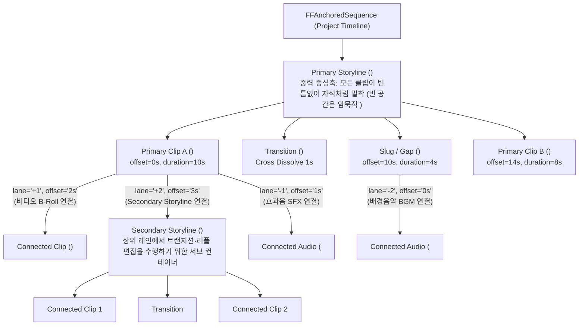
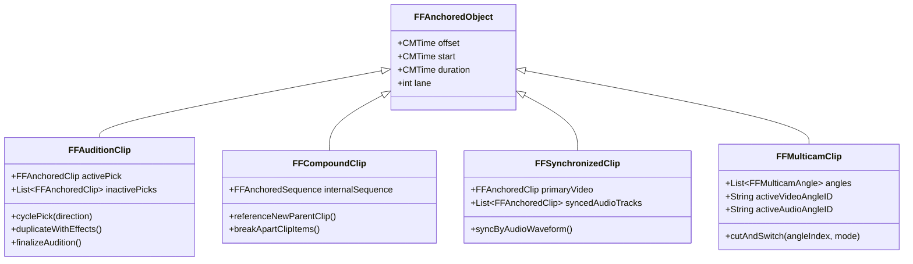
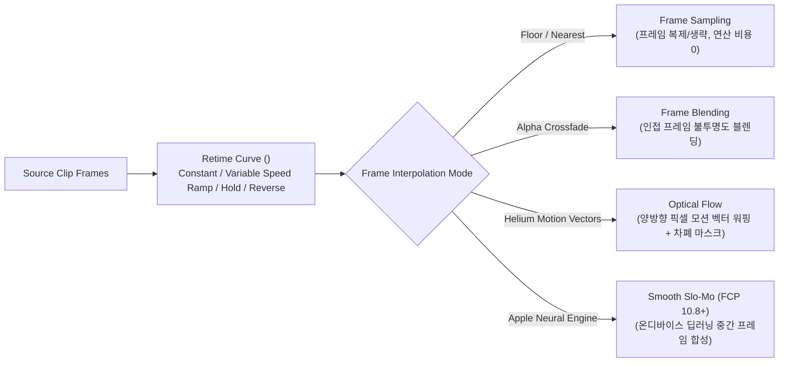

# Apple Final Cut Pro (10.x – 11.x) 전 계층 역공학 아키텍처 및 전 기능 심층 분석 보고서

본 문서는 `reverse-engineer-anything` 방법론에 기반하여 Apple **Final Cut Pro (10.6 ~ 11.0)** 의 내부 바이너리 프레임워크(`Flexo.framework`, `TLKit.framework`, `Helium.framework`, `Ozone.framework`, `ProCore.framework`, `ProAppsMIO.framework`), `.fcpbundle` 라이브러리 패키지 및 CoreData/SQLite 데이터베이스 스키마, `FCPXML 1.9–1.13` 교환 규격, 그리고 **인제스트·미디어 정리부터 Magnetic Timeline 2 편집, 컨테이너 클립, 멀티캠, 리타이밍, Wide Gamut HDR 색보정, Audio Roles/서라운드 믹싱, 온디바이스 AI(Magnetic Mask / Object Tracker / Transcribe to Captions / Smooth Slo-Mo / Smart Conform / Cinematic Mode), 3D 타이틀/모션 템플릿, 360° VR, 딜리버리**에 이르는 **전 기능을 빠짐없이 심층 해부**하고, 이를 **[FilmCraft](../filmcraft)** (49개 크레이트) 및 **[EffectCraft](../effectcraft)** (32개 크레이트)와 1:1 대조한 기술 레퍼런스입니다.

---

## 1. 내부 바이너리 & 프레임워크 아키텍처 (`Contents/Frameworks/`)

Final Cut Pro 애플리케이션 번들(`Final Cut Pro.app/Contents/Frameworks/`)은 단일 모놀리식 실행 파일이 아니라, 역할별로 정교하게 분리된 Private Framework 계층으로 동작합니다.



### 1.1 핵심 프레임워크별 내부 클래스 및 동작 원리

| 프레임워크 | 핵심 Objective-C / C++ 클래스 및 심볼 | 내부 동작 메커니즘 상세 | FilmCraft 대응 크레이트 |
| :--- | :--- | :--- | :--- |
| **`Flexo.framework`** | `FFLibrary`, `FFEvent`, `FFProject`, `FFAnchoredSequence`, `FFAnchoredCollection`, `FFAnchoredClip`, `FFAnchoredGap`, `FFAnchoredTransition`, `FFMedia`, `FFAsset`, `FFRole`, `FFSubrole`, `FFEffectStack`, `FFHeColorEffect`, `FFAudioWaveformGenerator` | FCP의 심장부. 모든 타임라인 요소는 `FFAnchoredObject`를 상속하며, 트랙 인덱스 대신 **부모-자식 앵커 그래프(Anchored Object Graph)** 로 관리됩니다. 백그라운드 작업(`FFBackgroundTaskManager`)으로 렌더, 프록시 트랜스코딩, 광학 흐름 분석, 파형 생성, 인물 분석을 스케줄링합니다. | [`filmcraft-project`](../filmcraft/crates/project), [`filmcraft-edit`](../filmcraft/crates/edit), [`filmcraft-engine`](../filmcraft/crates/engine), [`filmcraft-interchange`](../filmcraft/crates/interchange) |
| **`TLKit.framework`** | `TLKTimelineView`, `TLKItemLayer`, `TLKSpineLayer`, `TLKConnectionLineLayer`, `TLKTrimHandler`, `TLKSkimmingController`, `TLKPrecisionEditorView` | **Magnetic Timeline 2** 전용 UI 레이아웃 솔버. 주 스토리라인(`Spine`) 클립의 리플 이동 시 연결된 클립(`lane > 0` 비디오, `lane < 0` 오디오)의 수직 레인 충돌(Vertical Lane Collision Detection)을 계산하여 클립이 서로 겹치지 않게 자동으로 레인 높이를 재할당합니다. | [`filmcraft-ui-egui`](../filmcraft/crates/ui-egui), [`filmcraft-edit`](../filmcraft/crates/edit) |
| **`Helium.framework`** | `HGRenderer`, `HGNode`, `HGBitmap`, `HGXForm`, `HGColorMatrix`, `HGCrop`, `HGGaussianBlur`, `HGLut`, `HGMultiBlend`, `HGRect` (ROI / DoD) | Apple의 지연 평가(Lazy Evaluation) 기반 **DAG(방향성 비순환 그래프) GPU 렌더 엔진**. 각 프레임마다 전체 해상도를 무조건 렌더링하지 않고, 하류 노드가 요청하는 **ROI(Region of Interest)** 와 상류 노드가 제공하는 **DoD(Domain of Definition)** 의 교집합 타일만 32-bit Float Linear 색공간에서 Metal 커널로 계산합니다. | [`filmcraft-render`](../filmcraft/crates/render), [`filmcraft-gpu`](../filmcraft/crates/gpu), [`filmcraft-color`](../filmcraft/crates/color), [`filmcraft-frame`](../filmcraft/crates/frame) |
| **`Ozone.framework`** | `OZDocument`, `OZScene`, `OZSceneNode`, `OZLayer`, `OZGroup`, `OZTextLayer`, `OZShape`, `OZBehavior`, `OZRig`, `OZWidget`, `OZParticleEmitter`, `OZReplicator` | **Apple Motion의 런타임 엔진 전체**가 FCP 내부에 동일한 프레임워크로 내장되어 있습니다. 따라서 `.moti`(타이틀), `.motr`(트랜지션), `.moef`(이펙트), `.motn`(제너레이터) 파일은 별도 사전 렌더링 없이 FCP가 매 프레임 `OZScene`을 평가하여 `HGNode` 서브그래프로 변환해 실시간 합성합니다. | [`effectcraft-engine`](../effectcraft/crates/engine), [`effectcraft-render`](../effectcraft/crates/render), [`effectcraft-interchange::motion`](../effectcraft/crates/interchange/src/motion.rs) |
| **`ProCore.framework`** | `CMTime` 래퍼, `PCMatrix44Double`, `PCChangeLog`, `PCSerializer` | 정밀 유리수 시간(`value / timescale`) 연산, 4×4 동차 좌표 변환 행렬, 다단계 Undo/Redo 트랜잭션 스냅샷 관리를 담당합니다. | [`filmcraft-time`](../filmcraft/crates/time), [`filmcraft-geom`](../filmcraft/crates/geom) |
| **`ProAppsMIO.framework`** | `MIOAssetReader`, `MIOPlugin`, `RED`, `ARRI`, `Sony XAVC`, `CanonXF`, `ProResRAW` | 카메라 제조사별 RAW SDK 플러그인 아키텍처(RAD/Camera Archive) 및 Apple Silicon Media Engine(`VideoToolbox`) 하드웨어 가속 디코더/인코더 파이프라인입니다. | [`filmcraft-codecs`](../filmcraft/crates/codecs), [`filmcraft-prores`](../filmcraft/crates/prores), [`filmcraft-dng`](../filmcraft/crates/dng), [`filmcraft-dnx`](../filmcraft/crates/dnx), [`filmcraft-mxf`](../filmcraft/crates/mxf), [`filmcraft-isobmff`](../filmcraft/crates/isobmff) |

### 1.2 유리수 시간(Rational Time) 표현의 수학적 구조: `CMTime` vs. `Tick`

* **Final Cut Pro (`CMTime` & FCPXML Rational Strings)**:
  * 구조체: `struct CMTime { int64_t value; int32_t timescale; CMTimeFlags flags; int64_t epoch; }`
  * FCPXML 표현: `"<value>/<timescale>s"` (예: 23.976fps의 1프레임 = `"1001/24000s"`, 29.97fps의 1프레임 = `"1001/30000s"`, 24fps의 1프레임 = `"100/2400s"`, 48kHz의 1샘플 = `"1/48000s"`).
  * FCP는 비디오 클립 경계는 시퀀스의 `frameDuration` 정수배로 스냅(Frame Boundary Alignment)하지만, **오디오 서브프레임 트림 및 키프레임**은 **1/48,000초(오디오 샘플 단위)** 또는 **1/80 서브프레임(Subframe)** 정밀도로 허용합니다.
* **FilmCraft ([`filmcraft_time::Tick`](../filmcraft/crates/time/src/lib.rs) / [`filmcraft_project::time`](../filmcraft/crates/project/src/time.rs))**:
  * `TICKS_PER_SECOND = 254,016,000,000` ($2^{10} \times 3^4 \times 5^3 \times 7^2 \times 11 \times 1001$ 의 공배수 체계)를 사용하여 `23.976`, `24`, `25`, `29.97`, `30`, `48`, `50`, `59.94`, `60`, `119.88`, `120` fps와 `44,100`, `48,000`, `88,200`, `96,000`, `192,000` Hz 오디오 샘플을 **부동소수점 반올림 오차 0**의 64-bit 정수(`i64`)로 완벽히 통합 표현합니다.

---

## 2. 미디어 아키텍처: `.fcpbundle` 패키지 · 데이터베이스 · 인제스트 · 스마트 정리

### 2.1 `.fcpbundle` 라이브러리 패키지 내부 디렉터리 구조

Final Cut Pro의 라이브러리(`.fcpbundle`)는 macOS Finder에서는 단일 파일처럼 보이지만, 실제로는 CoreData 기반 SQLite 데이터베이스와 캐시/미디어 폴더로 구성된 디렉터리 번들입니다.

```text
MyProduction.fcpbundle/
├── Settings.plist                          # 스토리지 위치(Managed vs External), 백업 경로, 색상 공간(Standard vs Wide Gamut HDR)
├── CurrentVersion.flexolibrary             # 라이브러리 전역 카탈로그 DB (SQLite: 이벤트 목록, 전역 Roles 정의, Smart Collections)
├── __Sync__/                               # 백그라운드 작업 락 및 프로세스 간 상태 동기화
├── Motion Templates.localized/             # 라이브러리에 내장(저장)된 커스텀 Titles, Effects, Generators, Transitions
└── 2026-11-08_Shoot_Day1/                  # 개별 Event 디렉터리
    ├── CurrentVersion.fcpevent             # 핵심 CoreData SQLite DB (클립, 프로젝트 타임라인 그래프, 키워드, 마커, 이펙트 스택)
    ├── Original Media/                     # 원본 미디어 심볼릭 링크(External) 또는 실제 파일(Managed: Copy to Library)
    ├── Transcoded Media/
    │   ├── High Quality Media/             # Optimized Media (Apple ProRes 422 .mov)
    │   └── Proxy Media/                    # Proxy Media (ProRes 422 Proxy 또는 H.264, 50%/25%/540p/1080p)
    ├── Render Files/
    │   ├── High Quality Media/             # 타임라인 세그먼트별 해시 캐시 (Frame-segmented ProRes 422 / 4444 render chunks)
    │   ├── Peaks Data/                     # 오디오 파형 다중 해상도 피크 캐시 (.pkf)
    │   └── Thumbnail Media/                # 필름스트립 썸네일 스프라이트 캐시
    └── Analysis Files/
        ├── Optical Flow/                   # 양방향 모션 벡터 필드 파일 (.oflow)
        ├── Stabilization/                  # InertiaCam / SmoothCam 카메라 흔들림 행렬 분석 캐시
        └── Find People/                    # 얼굴/샷 타입(Wide/Medium/Close-up) ML 분석 메타데이터
```

### 2.2 미디어 정리 & 검색 시스템 (Browser & Collections)

1. **Keyword Collections (`FFKeywordCollection`, 단축키 `Cmd+K`)**
   - 폴더(Bin)가 파일 전체를 단 하나의 위치에만 넣는 전통적 NLE와 달리, FCP는 **단일 클립의 특정 시간 구간(예: `00:01:12:00` ~ `00:01:28:15`)에만 키워드를 부여(Range-based Tagging)** 할 수 있습니다.
   - 하나의 클립 안에 수십 개의 서로 겹치는(Overlapping) 키워드 구간을 지정할 수 있으며, `Cmd+K` HUD의 `Ctrl+1~9` 단축키로 촬영본을 재생하면서 실시간 태깅이 가능합니다.
   - 폴더 임포트 시 Finder 폴더 구조를 자동으로 Keyword Collection으로 변환(`Import Folders as Keyword Collections`)합니다.
2. **Rating & Range Selection (`F` / `Delete` / `U` / `R`)**
   - **Favorite (`F`, 초록색 바)**: 클립 전체 또는 `R`(Range Selection)로 지정한 인/아웃 구간을 베스트 테이크로 마킹하고 이름을 부여할 수 있습니다.
   - **Rejected (`Delete`, 빨간색 바)**: NG 컷 구간을 마킹합니다. 브라우저 필터를 `Hide Rejected`(`Ctrl+H`)로 두면 실제 파일을 삭제하지 않고도 NG 구간만 즉시 숨겨집니다.
   - **Unrated (`U`)**: 등급 해제.
3. **Smart Collections (`FFSmartCollection`) — 14가지 동적 쿼리 규칙**
   - SQLite 조건문으로 동작하는 동적 가상 폴더로, 다음 조건들을 `All` / `Any` 조합으로 필터링합니다:
     1. `Text`: 클립 이름, 노트, 마커 텍스트, 릴(Reel), 씬(Scene), 테이크(Take)
     2. `Ratings`: Favorites, Rejected, Unrated
     3. `Media`: Video with Audio, Video Only, Audio Only, Stills, Compound, Multicam, Synchronized, Auditions, Projects
     4. `Type` / `Format Info`: 코덱, 프레임 레이트, 해상도, 색공간(SDR/HDR), 카메라 이름(`Camera Name`), 카메라 앵글(`Camera Angle`)
     5. `Date`: 생성일(`Content Created`), 임포트일(`Date Imported`)
     6. `Roles`: 특정 비디오/오디오 Role 또는 Subrole 포함 여부
     7. `Keywords`: 특정 키워드 체크/해제 조합(AND/OR/NOT)
     8. `Used Media`: 현재 열린 프로젝트 타임라인에서 사용된 클립(`Used`) vs. 미사용 클립(`Unused`, 주황색 줄 표시와 연동)
     9. `People`: 머신러닝 분석으로 태깅된 `One Person`, `Two Persons`, `Group`, `Close Up Shot`, `Medium Shot`, `Wide Shot`
     10. `Stabilization`: `Excessive Shake` 감지 여부
     11. `Audio`: 샘플레이트, 채널 구성(Mono, Stereo, Surround, Polyphonic WAV)
4. **자동 인제스트 분석 (Ingest Background Analysis)**
   - **Color Balance Analysis**: 클립 대표 프레임의 화이트밸런스 캐스트를 사전 분석하여 타임라인에서 `Balance Color`(`Opt+Cmd+B`) 클릭 즉시 원클릭 보정.
   - **Find People & Shot Type**: 얼굴 검출 및 피사체 면적 비율을 계산하여 `Close Up Subject`, `Medium Shot`, `Wide Shot` 키워드 컬렉션을 자동 생성.
   - **Audio Analysis**: 무음 채널 자동 제거(`Remove Silent Channels`), 험 노이즈(50/60Hz), 과도한 배경 소음, 피크 클리핑 사전 검출 및 그룹핑.
   - **Scene Removal Mask / Stabilization Analysis**.
5. **프록시(Proxy) 및 최적화 미디어(Optimized Media) 워크플로우**
   - **Optimized Media**: Long-GOP 코덱(H.264/HEVC)을 I-Frame 전용 `Apple ProRes 422`로 트랜스코딩.
   - **Proxy Media**: `ProRes 422 Proxy` 또는 `H.264` 코덱 선택 가능, 프레임 크기를 원본 대비 `12.5%`, `25%`, `50%`, `100%` 또는 고정 해상도(`540p`, `960x540`, `1080p`)로 생성 가능.
   - **뷰어 재생 모드 3단계**:
     - `Optimized/Original`: 원본 또는 ProRes 422 재생
     - `Proxy Preferred`: 프록시가 있는 클립은 프록시로, 없는 클립은 원본으로 자동 폴백(Fallback) 재생 (FCP 10.4.9+ 핵심 기능)
     - `Proxy Only`: 프록시 전용 경량 라이브러리 외장 전달 모드 (`Copy Proxy Media to New Library`).

---

## 3. Magnetic Timeline 2 — 편집 메커니즘 · 토폴로지 · 트림 엔진 심층 해부

### 3.1 4계층 타임라인 그래프 토폴로지 (Trackless Anchored DAG)

전통적 NLE(Premiere Pro, Avid, DaVinci Resolve)가 시간축(X)과 고정 트랙 번호(Y: `V1, V2, A1, A2`)의 2차원 격자 배열에 클립을 배치하는 것과 달리, Final Cut Pro는 **4가지 계층 구조의 트리(DAG)** 로 타임라인을 구성합니다.



1. **Primary Storyline (`<spine>`)**:
   - 타임라인의 척추. 클립을 삽입(`W`)하면 뒤따르는 모든 클립이 오른쪽으로 밀려나고(Ripple Insert), 클립을 삭제(`Delete`)하면 뒤의 모든 클립이 왼쪽으로 당겨져 빈 공간을 메웁니다(Magnetic Close).
   - 만약 특정 시간대에 빈 공간이 필요하면 `Position Tool (P)` 또는 `Insert Gap (Opt+W)`을 통해 **실제 객체인 `<gap>` (Slug 클립)** 이 생성되어 자리를 차지합니다.
2. **Connected Clips (`lane != 0` & Connection Pin)**:
   - 주 스토리라인 위(`lane > 0`: B-roll 비디오, 자막, 그래픽)나 아래(`lane < 0`: 폴리 효과음, 대사, 배경음악)에 배치되는 모든 클립은 반드시 **주 스토리라인의 특정 클립 특정 프레임에 연결 핀(Connection Pin)으로 앵커링**됩니다.
   - **결정적 효과**: 앞부분 편집을 수정해 주 스토리라인의 `Clip A`가 5초 뒤로 밀리면, `Clip A`에 연결된 B-roll, 자막, 대사 효과음이 **싱크가 전혀 틀어지지 않고 함께 5초 뒤로 따라 이동**합니다.
   - **연결 핀 제어**:
     - `Cmd + Opt + 클릭`: 연결 핀을 현재 플레이헤드 위치의 다른 주 스토리라인 클립으로 재지정(Relocate Connection Point).
     - `` ` `` (Grave Accent / 물결표 키 누른 채 드래그): **Override Clip Connections** — 주 스토리라인 클립을 이동하거나 트림할 때 연결된 상·하위 클립은 제자리에 그대로 남겨두고 주 클립만 단독 조작.
3. **Secondary Storylines (`<spine lane="N">`)**:
   - 연결된 단일 B-roll 클립에 트랜지션을 걸거나 여러 B-roll 클립들을 마그네틱 리플 그룹으로 묶으면 상위 레인 안에 독립적인 `<spine>` 컨테이너가 생성됩니다.
   - `Opt + Cmd + Up Arrow` (`Lift from Storyline`): 주 스토리라인의 선택 클립을 상위 연결 클립으로 들어 올리고 원래 자리는 `<gap>`으로 대체합니다.
   - `Opt + Cmd + Down Arrow` (`Overwrite to Primary Storyline`): 상위 연결 클립을 주 스토리라인으로 내려 덮어씁니다.

### 3.2 4대 기본 편집 + 5대 Replace 편집 + 3-Point 편집 매트릭스

| 편집 명령 | 단축키 | 동작 원리 및 타임라인 변화 |
| :--- | :---: | :--- |
| **Append to Storyline** | `E` | 주 스토리라인의 맨 끝(End of Sequence)에 클립을 이어 붙입니다. |
| **Insert Edit** | `W` | 플레이헤드(또는 Skimmer) 위치에서 주 스토리라인 클립을 자르고(Blade) 새 클립을 끼워 넣으며, 뒷부분 전체를 오른쪽으로 밀어냅니다. |
| **Connect to Primary Storyline** | `Q` | 주 스토리라인을 건드리지 않고, 플레이헤드 위치의 주 스토리라인 클립에 핀으로 연결된 상위(`lane=+1`) 또는 하위(`lane=-1`, 오디오 전용일 때) 클립으로 얹습니다. |
| **Overwrite** | `D` (`Opt+D`) | 플레이헤드 위치부터 소스 클립 길이만큼 주 스토리라인의 기존 내용을 덮어씁니다(전체 시퀀스 길이 불변). |
| **Replace** | `Shift+R` | 타임라인의 대상 클립을 브라우저의 새 클립으로 교체합니다. 세부 5개 모드: ① `Replace` (타임라인 클립까지 덮어쓰고 새 클립 길이로 리플), ② `Replace from Start` (타임라인 클립 길이는 유지한 채 새 클립의 In 지점부터 채움), ③ `Replace from End` (새 클립의 Out 지점 기준 역산하여 채움), ④ `Replace with Retime to Fit` (타임라인 슬롯 길이에 딱 맞도록 새 클립의 재생 속도를 자동 가감속), ⑤ `Add to Audition` (교체하지 않고 오디션 후보로 추가). |
| **Backtimed Three-Point Edit** | `Shift+D` / `Shift+Q` | 브라우저에서 `In~Out` + 타임라인에서 `Out`만 찍거나, 브라우저에서 `Out` + 타임라인에서 `In~Out`을 찍어 **종료 프레임(예: 음악 비트 마지막 타격점)을 기준으로 역산 편집**을 수행합니다. |

### 3.3 7대 편집 도구 및 정밀 트림(Precision Trimming) 시스템

1. **Select Tool (`A`)**: 기본 선택, 클립 이동(Magnetic 재정렬), 가장자리 드래그 시 기본 Ripple Trim.
2. **Trim Tool (`T`)**:
   - **Ripple Trim** (편집점 좌/우 한쪽만 선택 후 드래그): 클립의 In 또는 Out 포인트를 늘리거나 줄이며, 뒤따르는 모든 주 스토리라인을 함께 밀고 당김.
   - **Roll Trim** (두 클립 사이 편집점 중앙 선택 후 드래그): 전체 타임라인 길이는 고정한 채, 앞 클립의 Out과 뒤 클립의 In을 동시에 이동(J/L 컷에서도 비디오/오디오 독립 Roll 가능).
   - **Slip Edit** (`T` 상태에서 클립 몸통 드래그): 타임라인 상의 클립 위치(Start)와 길이(Duration)는 고정한 채, 사용되는 **소스 미디어 내부의 In/Out 구간만 슬라이딩** (뷰어에 좌/우 2-Up 프레임으로 새로운 In/Out 프레임 실시간 표시).
   - **Slide Edit** (`T` 상태에서 `Opt` 누른 채 클립 몸통 드래그): 선택한 클립의 내용과 길이는 고정한 채 타임라인 위에서 좌우로 밀며, **양옆 인접 클립의 Out과 In이 그만큼 늘어나거나 줄어듦**.
3. **Position Tool (`P`)**:
   - 마그네틱 자석 효과를 일시 우회합니다. 클립을 들어 옮기면 원래 자리에 자동으로 `<gap>`이 생성되고, 옮긴 위치에 있던 기존 클립은 밀려나지 않고 덮어써집니다(전통적 트랙 NLE 동작과 동일).
4. **Range Selection Tool (`R`)**:
   - 클립 경계를 무시하고 임의의 시간 구간을 드래그 선택합니다.
   - 볼륨/오퍼시티 영역 조절 시 Range 양 끝에 **자동으로 4개의 키프레임(외곽 유지 2개 + 내부 변경 2개)** 을 생성하여 오디오 덕킹(Ducking)을 1초 만에 수행합니다.
5. **Blade Tool (`B` / `Cmd+B` / `Shift+Cmd+B`)**:
   - `B`: 클릭 지점 절단, `Cmd+B`: 플레이헤드 위치의 주/선택 클립 절단, `Shift+Cmd+B`: 플레이헤드 수직선 상의 **모든 레인(Primary + 모든 Connected Clips) 일괄 절단(Blade All)**.
   - 절단된 두 조각이 여전히 연속된 동일 소스 프레임일 경우 점선(**Through Edit Indicator**)이 표시되며, 편집점을 선택하고 `Delete`를 누르면 다시 하나의 무결점 클립으로 봉합(Heal Cut)됩니다.
6. **Precision Editor (`Ctrl+E`)**:
   - 편집점을 더블클릭하거나 `Ctrl+E`를 누르면 타임라인이 상하로 열리며, 앞 클립의 **사용되지 않은 여분 핸들(Unused Outgoing Handles)** 과 뒤 클립의 **사용되지 않은 여분 핸들(Unused Incoming Handles)** 전체를 흐린 필름스트립으로 펼쳐 보여줍니다.
7. **고속 트림 단축키 & J/K/L Dynamic Trimming**:
   - `Opt + [` (`Trim Start`): 플레이헤드 왼쪽부터 클립 시작점까지 즉시 잘라내고 리플(Top Trim).
   - `Opt + ]` (`Trim End`): 플레이헤드 오른쪽부터 클립 끝점까지 즉시 잘라내고 리플(Tail Trim).
   - `Opt + \` (`Trim to Playhead`): 플레이헤드가 클립의 앞쪽 절반에 있으면 Start를, 뒤쪽 절반에 있으면 End를 자동 판단해 트림.
   - `Shift + X` (`Extend Edit`): 선택한 편집점(비디오 또는 분할된 오디오 J/L 컷 가장자리)을 현재 플레이헤드 위치까지 즉시 스냅 이동.
   - `,` / `.` (쉼표/마침표): 선택한 편집점 또는 클립을 정확히 $\pm 1$ 프레임 이동 (`Shift + ,` / `Shift + .`는 $\pm 10$ 프레임 Nudge).
   - **Dynamic Trimming**: `T` 도구 활성화 후 `J` / `K` / `L`로 실시간 재생하면서 원하는 타이밍에 `K`를 누르거나 `[` / `]`를 누르면 재생 도중 실시간으로 편집점이 확정됩니다.

---

## 4. 4대 고급 컨테이너 클립 시스템 (Auditions · Compound · Synchronized · Multicam)



### 4.1 Auditions (`<audition>`, 단축키 `Y`)
* **개념**: 타임라인의 단 하나의 클립 슬롯 안에 여러 개의 대안 테이크(A안, B안, C안 또는 색보정 버전 1, 버전 2)를 스택으로 쌓아두고, 화살표 키(`Ctrl+Opt+Left/Right`)로 즉시 갈아끼워 보며 주 스토리라인이 실시간으로 리플 적응하는 기능입니다.
* **핵심 연산**:
  * `Create Audition (Cmd+Y)` / `Add to Audition (Shift+Cmd+Y)`
  * `Duplicate as Audition (Opt+Y)`: 현재 클립을 복제해 오디션 컨테이너로 만든 뒤 다른 이펙트/색보정을 테스트.
  * `Duplicate from Original (Shift+Opt+Cmd+Y)`: 이펙트가 적용되지 않은 순수 원본 클립을 후보에 추가.
  * `Finalize Audition (Opt+Shift+Y)`: 현재 선택된 Pick으로 확정하고 나머지 후보들을 제거.

### 4.2 Compound Clips (`<ref-clip>`, 단축키 `Opt+G`)
* **개념**: 타임라인의 여러 클립, 연결 클립, 오디오 레인을 하나의 가상 마스터 클립으로 캡슐화합니다(After Effects의 Pre-compose, Premiere의 Nest와 유사하지만 브라우저의 Event에 독립된 재사용 미디어 에셋으로 등록됨).
* **중요 특성**:
  * 브라우저에 생성된 부모 Compound Clip을 수정하면 타임라인에 배치된 모든 인스턴스에 동시에 반영됩니다.
  * 특정 인스턴스만 독립적으로 수정하고 싶을 때는 `Clip ▸ Reference New Parent Clip`을 실행해 부모 참조를 분기합니다.
  * Compound Clip 내부의 오디오는 바깥 타임라인의 `Show Audio Lanes`에서 **Role별 Submix 레인**으로 자동 합산되어 볼륨/이펙트를 일괄 제어할 수 있습니다.

### 4.3 Synchronized Clips (`<sync-clip>`, 단축키 `Opt+Cmd+G`)
* **개념**: 타임코드 젠록(Genlock) 없이 촬영된 DSLR/미러리스 비디오 클립과 외부 필드 레코더(Zoom, Sound Devices 등)의 멀티트랙 WAV 파일을 선택해 `Synchronize Clips`를 실행하면, **4단계 우선순위 알고리즘(① Timecode → ② Content Created → ③ First Marker → ④ Audio Waveform Cross-Correlation)** 으로 서브프레임 단위까지 정확히 정렬된 단일 `<sync-clip>`을 생성합니다.
* **자동 스크래치 오디오 비활성화**: 외부 오디오와 파형 매칭이 완료되면 카메라 내장 마이크의 저음질 스크래치 오디오 컴포넌트(`<audio-role-source active="0"/>`)를 자동으로 비활성화(Mute)하고 외부 레코더의 클린 오디오만 활성화합니다.

### 4.4 Multicam Engine (`<multicam>` / `<mc-clip>`, 단축키 `Shift+Cmd+7`)
* **앵글 동기화 엔진 (`Angle Synchronization`)**:
  * `Angle Assembly`: `Automatic`, `Camera Angle`, `Camera Name`, `Clips`(클립마다 개별 앵글 생성) 기준 자동 분류.
  * `Angle Synchronization`: 타임코드 + 오디오 파형 FFT 교차 상관(Cross-Correlation)을 결합하여 수십 개의 카메라 클립과 멀티트랙 마스터 오디오를 한 번에 정렬.
* **Angle Viewer (`Shift+Cmd+7`)**:
  * `2`, `4`, `9`, `16` 분할 화면 뱅크 지원, 타임코드/앵글 이름 오버레이 표시.
  * **3가지 스위칭 모드 아이콘**:
    1. **Video + Audio (캠코더+스피커 아이콘)**: 앵글 클릭 또는 숫자키 `1~9` 입력 시 비디오와 오디오를 동시에 컷 전환.
    2. **Video Only (비디오 아이콘, 실무 표준)**: 마스터 오디오 앵글(예: Angle 5 붐 마이크/콘솔 믹스)은 끊김 없이 계속 재생하면서 **비디오 카메라 앵글(`1~9`)만 실시간 컷 전환**.
    3. **Audio Only (스피커 아이콘)**: 비디오는 유지한 채 오디오 소스만 전환.
  * **Cut vs. Switch**:
    * 그냥 숫자키 `1~9` (또는 클릭): 현재 플레이헤드 위치에 칼자국(Blade Cut)을 내고 이후 구간의 앵글을 변경.
    * `Opt + 1~9` (`Opt + 클릭`): 새 컷을 만들지 않고 **현재 클립 조각 전체의 앵글을 다른 카메라로 교체(Switch)**.
* **Angle Editor (멀티캠 클립 더블클릭)**:
  * 특정 카메라 앵글 전체에 색보정(Color Wheels)이나 EQ를 한 번만 걸어두면, 본 타임라인에서 해당 카메라가 수백 번 컷 전환되어 등장하더라도 모든 컷에 일관된 색보정이 자동 적용됩니다.

---

## 5. 리타이밍(Retiming) · 스피드 램프 · Optical Flow · AI Smooth Slo-Mo



### 5.1 Retime Editor (`Cmd+R`) 상세 메커니즘
1. **Constant Speed & Automatic Speed (`Automatic Speed`)**:
   - 예: `23.976fps` 타임라인에 `119.88fps`로 촬영된 고프레임레이트(HFR) 클립을 올리고 `Retime ▸ Automatic Speed`를 실행하면, 프레임 손실이나 보간 없이 원본 모든 프레임을 1:1로 매핑하는 정확한 **20% 슬로우 모션**으로 즉시 변환됩니다.
2. **Variable Speed (Speed Ramp) & Blade Speed (`Shift+B`)**:
   - 클립 도중 `Shift+B`를 누르면 클립 자체는 쪼개지지 않고 **리타임 바(Retime Bar)에 속도 구간 분할점**만 생성됩니다.
   - 두 속도 구간(예: `100%` → `25%`) 사이의 회색 전환 핸들(**Speed Transition Handle**)을 좌우로 넓히면 가속도 곡선(Ease-In / Ease-Out Bezier)이 부드럽게 생성됩니다.
   - 각 속도 세그먼트의 끝점을 드래그하면 소스 인/아웃을 바꾸는 대신 세그먼트의 재생 속도가 실시간 재계산되며, `Retime ▸ Change End Source Frame`으로 전환하면 속도는 유지하고 소스 프레임을 트림할 수 있습니다.
3. **Hold Segment (`Shift+H`) vs. Freeze Frame (`Opt+F`)**:
   - **Hold (`Shift+H`)**: 클립 내부에 빨간색 정지 구간을 삽입합니다. 정지된 구간에도 원본 클립에 걸린 그레인, 색보정, 키프레임 이펙트가 그대로 살아 움직입니다.
   - **Freeze Frame (`Opt+F`)**: 현재 프레임을 독립된 스틸 클립으로 추출해 삽입합니다.
4. **특수 리타임 프리셋**:
   - **Instant Replay**: 선택한 구간을 복제해 뒤에 붙이고 지정된 속도(예: `50%`)로 슬로우 리플레이 + 자동 `Instant Replay` 타이틀 오버레이 생성.
   - **Rewind**: 선택 구간을 복사해 고속 역재생(`-400%`) 후 다시 정방향 재생으로 연결.
   - **Jump Cut at Markers**: 박자 마커마다 지정된 프레임 수(예: 3프레임, 5프레임, 10프레임)를 자동으로 잘라내어 뮤직비디오 스타일 점프컷 생성.
5. **Preserve Pitch**: 속도를 50%나 200%로 바꿔도 오디오의 음정(Pitch)이 변조되지 않도록 위상 보코더(Phase Vocoder) 타임 스트레칭을 자동 수행합니다.

---

## 6. 색보정(Color Grading) · Wide Gamut HDR · Camera LUT · 비디오 스코프

### 6.1 색상 관리(Color Management) 및 HDR 파이프라인

Final Cut Pro는 라이브러리 속성(`ModifySettings`)에서 두 가지 컬러 프로세싱 모드를 제공합니다:
1. **Standard (`Rec.709`)**:
   - 전통적인 SDR 방송/웹 표준(`Rec.709` 색역, 2.4 감마, 최대 휘도 100 nits 기준).
2. **Wide Gamut HDR (`Rec.2020 Linear` 32-bit Float 작업 공간)**:
   - 프로젝트 타임라인 설정에서 **`Rec.2020 HLG`** (Hybrid Log-Gamma, 방송/YouTube HDR) 또는 **`Rec.2020 PQ`** (Perceptual Quantizer SMPTE ST 2084, 최대 10,000 nits, Dolby Vision / HDR10 마스터링) 선택 가능.
   - **Automatic Color Conform**: SDR(`Rec.709`), HLG, PQ, Log 클립을 한 타임라인에 섞어 넣어도 FCP가 에셋 메타데이터를 읽어 프로젝트 타겟 색공간으로 자동 역톤매핑/순방향 톤매핑을 수행합니다.
   - **HDR Tools 이펙트**: `HLG to Rec. 709 SDR`, `PQ to Rec. 709 SDR`, `PQ to HLG`, `HDR Tone Map`, `Range Limit` (지정된 니트 예: 1,000 nits 초과 하이라이트 소프트 롤오프).

### 6.2 2단계 LUT 파이프라인: `Camera LUT` vs. `Custom LUT`
* **1단계 — Inspector `Camera LUT` (Scene-Referred 입력 변환)**:
  * 브라우저나 인스펙터의 `Info ▸ General/Extended`에서 클립 메타데이터로 지정합니다.
  * 내장 프리셋: `Apple Log`, `ARRI LogC3`, `ARRI LogC4`, `Canon Log 2`, `Canon Log 3`, `Panasonic V-Log`, `RED Log3G10 / REDWideGamutRGB`, `Sony S-Log2`, `Sony S-Log3 / S-Gamut3.Cine`, `Blackmagic Design Film Gen 4/5`.
  * **장점**: 모든 색보정 필터보다 **가장 앞단(Pre-Effect)** 에서 카메라 Log 신호를 라이브러리의 작업 색공간(Standard Rec.709 또는 Wide Gamut Rec.2020)으로 정확히 정규화합니다.
* **2단계 — Effects `Custom LUT` (Output / Creative Look 변환)**:
  * 이펙트 스택의 원하는 순서에 배치하여 `.cube` / `.3dl` 크리에이티브 룩 LUT를 적용하며, `Input Color Space`, `Output Color Space`, 그리고 `Mix`(`0.0` ~ `1.0` 강도 블렌딩) 슬라이더를 제공합니다.

### 6.3 5대 네이티브 색보정 도구 상세 (단축키 `Cmd+6`)

하나의 클립에 다음 5가지 색보정 인스턴스를 개수 제한 없이 원하는 순서대로 스택(Stack)으로 쌓을 수 있습니다:

| 색보정 도구 | 세부 파라미터 및 수학적 제어 구조 |
| :--- | :--- |
| **1. Color Board** | FCPX 고유의 고속 4-Puck 인터페이스. **Color**(색상 각도 $0^\circ \sim 360^\circ$ 및 강도 $\pm 100\%$), **Saturation**(채도 $\pm 100\%$), **Exposure**(노출 $\pm 100\%$) 3개 탭 각각에 `Master`, `Shadows`, `Midtones`, `Highlights` 4개의 퍽(Puck)이 존재합니다. |
| **2. Color Wheels** | 전문가용 4-Wheel (`Master`, `Shadows`, `Midtones`, `Highlights`). 각 휠은 중앙 컬러 퍽(Chroma Vector) + 좌측 채도 슬라이더(Saturation) + 우측 밝기 슬라이더(Luma/Exposure)를 한 화면에서 동시에 조작하며, 하단에 전역 `Temperature`(색온도 Kelvin), `Tint`(그린/마젠타), `Hue`(색상 회전), `Mix`(적용 비율)를 제공합니다. |
| **3. Color Curves** | `Luma`, `Red`, `Green`, `Blue` 4개의 독립 3차 베지어 스플라인 커브. 뷰어에서 스포이드로 특정 픽셀을 클릭하면 4개 커브의 해당 입력값 지점에 제어점이 동시에 찍히며, `Luma` 커브의 RGB 가중치 비율을 커스텀 조절할 수 있습니다. |
| **4. Hue/Saturation Curves** | 6종의 세컨더리 곡선: ① **Hue vs Hue** (특정 색상을 다른 색상으로 변경), ② **Hue vs Sat** (특정 색상만 채도 증감), ③ **Hue vs Luma** (특정 색상의 밝기만 조절 — 예: 파란 하늘만 어둡게), ④ **Luma vs Sat** (암부나 하이라이트의 채도만 제거하여 필름 롤오프 구현), ⑤ **Sat vs Sat** (이미 채도가 높은 영역의 과포화 방지), ⑥ **Orange(Custom Color) vs Sat** (피부톤 대역의 채도를 정밀 제어). |
| **5. Color Adjustments (FCP 10.8+)** | 머신러닝 기반 **Enhance Light and Color** 원클릭 자동 보정과 연동되는 슬라이더형 그레이딩 도구: `Light`(`Exposure`, `Contrast`, `Brightness`, `Highlights`, `Black Point`, `Shadows`), `Color`(`Saturation`, `Warmth`, `Tint`). |

### 6.4 색보정 전용 마스킹: Color Mask · Shape Mask · Magnetic Mask · Inside/Outside 분리
FCP의 모든 색보정 인스턴스는 별도의 Adjustment Layer나 노드 트리 없이도 **그 자체에 내장된 다중 마스크**와 **Inside / Outside 양면 보정 탭**을 가집니다:
* **Color Mask (3D HSL Qualifier)**: 스포이드로 피부톤이나 하늘을 드래그하면 HSL 3차원 공간의 타원체 범위를 추출하며 `Softness`로 경계를 부드럽게 풀고 `View Masks`로 흑백 매트를 확인합니다.
* **Shape Mask**: 내/외측 이중 링(Inner/Outer Feather Ring)과 곡률 핸들(원에서 사각형까지 연속 변형)을 가진 베지어/수퍼엘립스 마스크를 여러 개 추가해 `Add`, `Subtract`, `Intersect` 불리언 연산을 수행합니다.
* **Magnetic Mask & Object Tracker 연동**: AI가 분리한 인물(`Magnetic Mask`)이나 추적된 객체(`Object Tracker`)를 색보정 마스크로 즉시 바인딩합니다.
* **Inside vs. Outside 탭**: 마스크를 한 번만 따면 **`Inside` 탭에서는 피사체(인물 피부톤)를 밝히고, `Outside` 탭으로 전환해 배경만 어둡고 차갑게 누르는 비네팅/분리 보정**을 단 하나의 색보정 노드 안에서 끝낼 수 있습니다.

### 6.5 비디오 스코프 (`Cmd+7`) & Comparison Viewer (`Ctrl+Cmd+6`)
* **Waveform**: `Luma`, `RGB Parade`, `RGB Overlay`, `Y'CbCr Parade` (IRE `-20`~`120` 또는 HDR `0`~`10,000 nits` 스케일).
* **Vectorscope**: 색차(Chroma) 위상 각도 및 채도 표시, **Skin Tone Indicator Line (I-Line, 약 $123^\circ$)** 기본 제공으로 인종과 무관하게 혈류 기반 피부톤 기준선 정렬 지원.
* **Histogram**: `Luma`, `RGB`, `RGB Parade` 분포도.
* **Range Check (제브라 패턴 오버레이)**: 방송 규격(`Rec.709` Luma $100\%$ 초과 또는 Chroma 과포화 영역)을 뷰어 화면 위에 사선 줄무늬(Zebra Stripes)로 실시간 경고.
* **Comparison Viewer**: 타임라인의 다른 클립이나 `Frame Browser`에 저장한 레퍼런스 스틸과 현재 클립을 수평/수직 분할 와이프(Split Wipe)로 나란히 비교하고, 스코프도 2-Up으로 동시에 띄워 샷 매칭(Shot Matching)을 수행합니다.

---

## 7. 오디오 포스트 프로덕션 · Roles 아키텍처 · 서라운드 & Logic Pro AU DSP

### 7.1 Roles & Subroles 아키텍처 (`FFRole`)
Final Cut Pro가 트랙 번호(`A1, A2, A3...`)를 버리고 도입한 가장 혁신적인 오디오/비디오 분류 체계입니다.
* **기본 5대 Role**:
  * Video Roles: `Titles`, `Video`
  * Audio Roles: `Dialogue` (대사), `Effects` (효과음), `Music` (음악)
* **Subroles (`dialogue.boom`, `dialogue.lav-1`, `effects.foley`, `effects.ambience`)**:
  * 멀티트랙 필드 레코더(Sound Devices, Zoom, Zaxcom)가 기록한 Broadcast WAV의 **iXML 메타데이터 트랙 이름**을 읽어 임포트 시 자동으로 `Dialogue-1 (Boom)`, `Dialogue-2 (Actor A)` 등의 Subrole을 생성·할당합니다.
* **Timeline Index (`Shift+Cmd+2`) `Roles` 탭의 위력**:
  * **Show Audio Lanes**: 체크하는 순간 타임라인 하단이 Role/Subrole별 전용 수평 레인으로 깔끔하게 분리 정렬됩니다(모든 대사는 대사 레인끼리, 효과음은 효과음 레인끼리, 음악은 음악 레인끼리 모임).
  * **Focus Role**: 특정 Role만 정상 높이로 펼치고 나머지 Role은 얇은 미니 바 형태로 접어 편집 집중도를 극대화합니다.
  * **Compound Clip Role Submix**: 타임라인 전체를 Compound Clip으로 감싸고 `Show Audio Lanes`를 켜면, 전체 대사(`Dialogue`), 전체 효과음(`Effects`), 전체 음악(`Music`)이 각각 하나의 **마스터 버스(Bus) 컴포넌트**로 나타나 Role 전체에 컴프레서나 리미터를 한 번에 걸 수 있습니다.

### 7.2 Audio Configuration & Component Expansion
* **채널 구성**: `Mono`, `Stereo`, `Dual Mono`(좌/우 채널을 2개의 독립 모노 컴포넌트로 분리), `5.1 Surround`, `Adaptive`.
* **Expand Audio (`Ctrl+S`) vs. Expand Audio Components (`Ctrl+Opt+S`)**:
  * `Ctrl+S`: 비디오와 오디오 바를 상하로 분리하여 J-Cut / L-Cut 비대칭 트림 수행.
  * `Ctrl+Opt+S`: 클립 내부에 들어 있는 다중 마이크 채널(예: 붐 마이크 + 핀 마이크 1 + 핀 마이크 2)을 개별 서브레인(Audio Components)으로 펼쳐서 **필요 없는 마이크 구간은 Range 도구(`R`)로 볼륨을 내리거나 비활성화**하고, 각 마이크 채널마다 서로 다른 EQ와 노이즈 제거를 적용합니다.

### 7.3 내장 오디오 향상 & Logic Pro AU DSP 플러그인 스위트
1. **Audio Enhancements 인스펙터**:
   - **Loudness**: `Amount`(컴프레션 강도) & `Uniformity`(클립 간 음량 편차 평준화).
   - **Noise Removal** & **Voice Isolation (AI)**: Apple Neural Engine 기반 실시간 보이스 분리(거리 소음, 에어컨 소리, 바람 소리를 완벽히 제거하고 사람의 목소리만 추출).
   - **Hum Removal**: `50 Hz` 또는 `60 Hz` 전원 접지 험 노이즈 및 고조파(Harmonics) 노치 필터링.
   - **Equalization & Match Audio (`Opt+Cmd+M`)**: 10-Band / 31-Band Graphic EQ 및 다른 클립의 주파수 스펙트럼 응답을 분석해 현재 클립의 음색을 자동으로 맞춰주는 `Match Audio`.
2. **내장 Logic Pro Audio Units (60종 이상)**:
   - Dynamics: `Compressor` (7개 회로 모델: Platinum Digital, Studio VCA, Studio FET, Classic VCA, Vintage VCA, Vintage FET, Vintage Opto), `Limiter`, `Adaptive Limiter`, `Multiband Compressor`, `DeEsser 2`, `Noise Gate`, `Enveloper`
   - Reverb & Delay: `Space Designer` (실제 공간 IR 컨볼루션 리버브), `ChromaVerb`, `SilverVerb`, `Stereo Delay`, `Tape Delay`
   - Voice & Pitch: `Pitch Shifter`, `Vocal Transformer`, `Ringshifter`
3. **5.1 Surround Panner**:
   - 원형 사운드필드 퍽 + `Mode` (`Create Space`, `Location`, `Rotation`, `Surround`, `Circle`, `Music`, `Collapse`), `Center Bias`, `LFE Balance`, `Width`, `Rotation` 키프레임 지원.

---

## 8. 온디바이스 AI & 머신러닝 기능군 (FCP 10.6 ~ FCP 11)

| AI 기능 | 도입 버전 | 구동 프레임워크 / 모델 | 상세 작동 원리 및 워크플로우 |
| :--- | :---: | :--- | :--- |
| **Magnetic Mask** | FCP 11.0 | `Vision` + `CoreML` (Apple Silicon ANE 비디오 객체 분할 모델) | 크로마키(그린스크린) 없이 영상 속 인물, 동물, 자동차, 사물을 클릭 한 번으로 즉시 정밀 분리(Rotoscoping)합니다. `+` / `-` 컨트롤 포인트와 브러시로 영역을 보정한 뒤 `Analyze`를 누르면 전체 프레임의 모션과 가려짐(Occlusion)을 추적해 알파 매트를 생성합니다. 피사체 뒤로 3D 텍스트를 넣거나 색보정(Inside/Outside)에 직결됩니다. |
| **Transcribe to Captions** | FCP 11.0 | 온디바이스 Speech-to-Text LLM | 타임라인의 대사 오디오 Role을 분석해 프레임 단위 타임코드가 일치하는 닫힌 자막(`Caption Lane`)을 자동으로 생성합니다. 클립을 마그네틱 타임라인에서 이동시키면 연결된 자막도 함께 이동합니다. |
| **Object Tracker** | FCP 10.6 | `Vision.framework` + `Metal` Point Grid / ML Combined Tracker | 뷰어에서 얼굴이나 사물 위에 트래커 그리드를 놓으면 앞뒤 프레임의 이동(`Offset`), 회전(`Rotation`), 크기(`Scale`), 원근 왜곡을 실시간 추적합니다. 하나의 클립에 여러 개의 트래커를 저장할 수 있으며, 타이틀, 이펙트, 드롭존, 셰이프 마스크를 트래커에 드래그 앤 드롭하여 고정(Pinning)합니다. |
| **Smooth Slo-Mo** | FCP 10.8 | Apple Silicon Neural Engine 광학 흐름 합성 | 기존 Optical Flow에서 발생하던 모션 블러 왜곡(Warping Artifact)을 극복하기 위해 신경망이 연속 프레임 사이의 비선형 움직임을 추론해 새로운 중간 프레임을 그리는 최고 화질 슬로우 모션 알고리즘입니다. |
| **Enhance Light and Color** | FCP 10.8 | CoreML 컬러 밸런스·톤 매핑 신경망 | SDR 및 HDR/Log 영상의 히스토그램과 인물 피부톤을 분석해 노출, 화이트밸런스, 대비, 블랙/화이트 포인트를 원클릭으로 최적화합니다. |
| **Cinematic Mode Editing** | FCP 10.6 | `CoreMedia` Disparity Map + `Helium` Depth Bokeh | iPhone 시네마틱 모드로 촬영된 영상의 깊이 맵(Depth Map) 메타데이터를 디코딩하여, 편집 도중 **가상 조리개 값(`f/2.0` ~ `f/16`)을 키프레임으로 조절**하고, **초점 대상(Focus Point)을 클릭 한 번으로 배경 인물에서 전면 인물로 랙 포커스(Rack Focus)** 전환합니다. |
| **Smart Conform** | FCP 10.4.9 | `Vision` Saliency / Face & Action Detector | `16:9` 가로 프로젝트를 `9:16`(릴스/쇼츠), `1:1`, `4:5` 세로 프로젝트로 복제할 때 모든 클립의 주요 피사체/얼굴 움직임을 분석하여 피사체가 화면 밖으로 잘리지 않도록 자동으로 팬(Transform Position X) 키프레임을 생성합니다. |
| **Voice Isolation** | FCP 10.6.2 | CoreAudio Neural Speech Denoiser | 야외 촬영 소음 속에서 성우/배우의 음성 주파수 포먼트만 실시간 분리 추출합니다. |
| **Scene Removal Mask** | FCP 10.6.6 | Background Difference Matting | 피사체가 들어오기 전(또는 나간 후)의 빈 배경 프레임(Clean Plate) 1장을 기준으로 피사체만 자동으로 누끼 분리하는 실시간 차이 매트 이펙트입니다. |

---

## 9. Motion 템플릿 호스팅 · 3D 텍스트 · 닫힌 자막(Captions) · 360° VR

### 9.1 Motion 4대 템플릿 호스팅 (`Ozone.framework`)
* **Titles (`.moti`)**, **Generators (`.motn`)**, **Transitions (`.motr`)**, **Effects (`.moef`)**.
* **지능형 템플릿 타이밍 마커 (Adaptive Timing)**:
  * FCP 타임라인에서 타이틀 길이를 5초에서 15초로 늘릴 때, 앞부분 1초 등장 애니메이션(`Build In`)과 뒷부분 1초 퇴장 애니메이션(`Build Out`)의 속도는 원래대로 유지하고 **가운데 정지 구간만 13초로 늘어나도록** Motion의 `Build In Optional/Mandatory`, `Build Out Optional/Mandatory`, `Project Loop End` 마커를 해석합니다.
* **Open in Motion**: 기본 내장 템플릿에서 우클릭 → `Open a Copy in Motion`을 누르면 즉시 Apple Motion이 실행되어 내부 노드, Behavior, Rig를 수정하고 커스텀 템플릿으로 재저장할 수 있습니다.

### 9.2 실시간 3D Text 엔진
* 별도 3D 플러그인 없이 모든 2D 텍스트 인스펙터에서 `3D Text` 스위치를 켜면 즉시 3차원 메쉬로 돌출됩니다:
  * **Geometry**: `Depth`(돌출 깊이), `Depth Direction`(Backward/Forward/Centered), `Weight`(두께), `Front Edge`(None, Bevel, Round, Concave, Ridge, Square, Ring), `Front Edge Size`, `Back Edge`, `Inside Corners`(Mitre/Round/Bevel).
  * **Lighting**: `Lighting Style`(Standard, Backlit, Medium, Left, Right, Diagonal, Drama, Top, Bottom), `Intensity`, `Self Shadows`(글자 간 자기 그림자), `Environment`(HDRI 환경 반사 맵: Chrome, Gold, Studio, Forest 등).
  * **Materials (`Multiple` 레이어 재질 합성)**:
    * `Substance`(Plastic, Metal, Paint, Wood, Stone, Fabric, Glass, Gold/Silver), `Finish`(광택도), `Distress`(표면 풍화 효과: Bumps, Dents, Scratches, Stains, Worn, Grubby), `Placement`(재질을 앞면/측면/모서리 중 어디에 입힐지 독립 지정).

### 9.3 방송·OTT 닫힌 자막(Closed Captions) 엔진
* **3대 자막 포맷 네이티브 지원**:
  1. **`CEA-608`**: 북미 방송 표준(Line 21). 한 줄 최대 32자, 최대 4줄 제한, `Pop-On`, `Paint-On`, `Roll-Up (2/3/4 rows)` 스타일, 8가지 텍스트 색상 및 배경 불투명도, 화면 내 상/하/좌/우 정확한 그리드 배치, 영상 파일(QuickTime/MXF) 내부 트랙 임베딩 지원.
  2. **`iTT` (iTunes Timed Text)**: Apple TV+, iTunes Store, YouTube 다국어 자막 표준. 유니코드 다국어(한국어, 일본어, 아랍어 루비/세로쓰기 등), 색상 및 화면 배치 지원.
  3. **`SRT` (SubRip)**: 범용 소셜 미디어 및 웹 플레이어 표준.
* **실시간 규격 검증기 (Caption Validator)**:
  * 같은 언어 레인 안에서 두 자막 클립이 시간적으로 겹치거나, CEA-608의 글자 수 제한(32자)을 초과하거나, 유효하지 않은 문자가 들어가면 자막 클립이 **즉시 빨간색으로 변하며 인스펙터에 구체적인 오류 원인과 원클릭 해결(`Resolve Overlaps`) 버튼**을 제공합니다.
* **다국어 자막 레인**: 하나의 타임라인 안에 한국어, 영어, 일본어, 스페인어 자막 레인을 동시에 두고 익스포트 시 언어별 개별 파일로 뽑거나 한 번에 멀티플렉싱할 수 있습니다.

### 9.4 360° VR 비디오 편집 시스템
* **프로젝션 지원**: `Equirectangular`(정거원통도법) `Monoscopic`(단안) 및 `Stereoscopic`(`Over/Under`, `Side-by-Side` 양안 입체 3D).
* **360° Viewer (`Shift+Cmd+8`)**: 평면 뷰어 옆에 실제 구면(Spherical) 투영 시점을 마우스로 돌려보거나 HTC Vive / SteamVR / Apple Vision계열 HMD로 실시간 출력.
* **전용 360° 도구**:
  * **Reorient (Tilt / Pan / Roll)**: 360° 카메라가 기울어진 채 촬영되었을 때 수평선(Horizon)과 정면 방향(Forward Vector)을 재정렬.
  * **360° Patch**: 구면 바닥(Nadir)에 찍힌 삼각대를 주변 바닥 텍스처로 자연스럽게 복제해 지우거나 로고 패치를 구면 왜곡에 맞춰 삽입.
  * **Seam-Aware 360° Effects**: 일반 2D 블러나 글로우를 360° 영상에 걸면 좌우 끝 경계선($-180^\circ$와 $+180^\circ$가 만나는 지점)에 검은 줄(Seam)이 생기는데, FCP의 `360° Blur`, `360° Glow`, `360° Sharpen`, `360° Title`은 구면 연속성을 계산하여 이음매 아티팩트가 전혀 발생하지 않습니다.
  * **Tiny Planet Projection**: 일반 16:9 평면 타임라인에 360° 클립을 올리고 `360° Transform ▸ Mapping: Tiny Planet`을 선택하면 극좌표 소행성 뷰를 실시간 키프레임 애니메이션할 수 있습니다.

---

## 10. FCPXML (1.9 – 1.13) 스키마 명세 및 딜리버리(Share) 아키텍처

### 10.1 FCPXML 1.9 ~ 1.13 버전별 스키마 진화 내역

| FCPXML 버전 | 도입 FCP 버전 | 주요 스키마 추가 및 변경 사항 |
| :---: | :---: | :--- |
| **1.9** | FCP 10.4.9 | 프록시 워크플로우 강화, `Smart Conform` 메타데이터, 오디오 크로스페이드 S-커브 속성 정교화 |
| **1.10** | FCP 10.6 | `<adjust-tracker>`(Object Tracker), `<adjust-cinematic>`(iPhone 시네마틱 심도/포커스 포인트), `<adjust-voice-isolation>` 추가 |
| **1.11** | FCP 10.6.6+ | 자동 컬러 관리(`colorProcessing`), Scene Removal Mask, 향상된 ACES / HDR 메타데이터 |
| **1.12** | FCP 10.8 | `Enhance Light and Color` (`<filter-video>` 컬러 조정 파라미터), `Smooth Slo-Mo` 리타임 품질 속성 추가 |
| **1.13** | FCP 11.0 | `Magnetic Mask` 세그멘테이션 마스크 참조, 향상된 캡션 트랜스크립션 메타데이터, 공간 비디오(Spatial Video MV-HEVC) 스테레오 속성 지원 |

### 10.2 FCPXML 핵심 DOM 트리 구조

```xml
<?xml version="1.0" encoding="UTF-8"?>
<!DOCTYPE fcpxml>
<fcpxml version="1.13">
  <resources>
    <format id="r1" name="FFVideoFormat3840x2160p2398" frameDuration="1001/24000s" width="3840" height="2160" colorSpace="1-1-1 (Rec. 709)"/>
    <asset id="r2" name="A001_C001" uid="..." src="file:///.../A001_C001.mov" start="0s" duration="240240/24000s" hasVideo="1" hasAudio="1" audioSources="1" audioChannels="2" audioRate="48000"/>
    <effect id="r3" name="Cross Dissolve" uid=".../Cross Dissolve"/>
    <media id="r4" name="Multicam_Interview">
      <multicam format="r1" tcStart="0s">
        <mc-angle name="Cam A" angleID="angA">...</mc-angle>
        <mc-angle name="Cam B" angleID="angB">...</mc-angle>
      </multicam>
    </media>
  </resources>
  <library location="file:///.../Show.fcpbundle/">
    <event name="Ep01">
      <project name="Ep01_Edit_v1">
        <sequence format="r1" duration="1201200/24000s" tcStart="0s" tcFormat="NDF" audioLayout="stereo" audioRate="48k">
          <spine>
            <asset-clip ref="r2" offset="0s" name="A001_C001" start="10010/24000s" duration="120120/24000s" audioRole="dialogue.boom">
              <adjust-conform type="fit"/>
              <adjust-transform position="0 0" scale="1.2 1.2" rotation="0" anchor="0 0"/>
              <adjust-blend amount="1" mode="normal"/>
              <adjust-volume amount="-3dB"/>
              <adjust-panner mode="stereo" amount="-0.25"/>
              <timeMap>
                <timept time="0s" value="0s" interp="smooth2"/>
                <timept time="60060/24000s" value="120120/24000s" interp="smooth2"/>
              </timeMap>
              <!-- Connected B-Roll on Lane +1 -->
              <asset-clip ref="r2" lane="1" offset="24024/24000s" duration="48048/24000s" start="0s"/>
              <!-- Connected Sound Effect on Lane -1 -->
              <audio ref="r2" lane="-1" offset="12012/24000s" duration="24024/24000s" role="effects.sfx" srcID="1"/>
              <marker start="10010/24000s" duration="1001/24000s" value="VFX Shot"/>
            </asset-clip>
            <transition name="Cross Dissolve" offset="110110/24000s" duration="24024/24000s">
              <filter-video ref="r3" name="Cross Dissolve"/>
            </transition>
            <mc-clip ref="r4" offset="120120/24000s" duration="240240/24000s">
              <mc-source angleID="angA" srcEnable="video"/>
              <mc-source angleID="angB" srcEnable="audio"/>
            </mc-clip>
          </spine>
        </sequence>
      </project>
    </event>
  </library>
</fcpxml>
```

### 10.3 Share & Roles 기반 멀티트랙/스템 익스포트 아키텍처
Final Cut Pro의 `Share ▸ Export File (Master File)`에서 **`Roles` 탭**은 방송국/OTT 납품에 필수적인 4가지 출력 토폴로지를 제공합니다:
1. **QuickTime Movie (Single Merged Track)**: 일반 스테레오 또는 5.1 마스터 파일 출력.
2. **Multitrack QuickTime Movie**: 단일 `.mov` 파일 내부에 **각 Audio Role(`Dialogue`, `Music`, `Effects`)을 독립된 오디오 트랙(Track 1, Track 2, Track 3)** 으로 패킹하여 출력 (방송국 M&E — Music & Effects 트랙 분리 납품 표준).
3. **Separate Files (Audio Stems + Video)**: 한 번의 익스포트 클릭으로 비디오 마스터 `.mov` 파일과 함께 `Project_Dialogue.wav`, `Project_Effects.wav`, `Project_Music.wav` 스템 파일들을 동시에 개별 파일로 구워냅니다.
4. **Destinations Bundles**: 여러 Share 세팅(예: ProRes 422 HQ 마스터 + H.264 1080p 클라이언트 프리뷰 + SRT 자막 + 썸네일 이미지)을 하나의 **Bundle** 폴더로 묶어 한 번에 동시 출력합니다.

---

## 11. Final Cut Pro vs. FilmCraft (49개 크레이트) 전 영역 1:1 정밀 매핑 매트릭스

| 기능 도메인 | Final Cut Pro 세부 기능 | FilmCraft 구현 크레이트 및 모듈 | 구현 수준 및 기술적 분석 |
| :--- | :--- | :--- | :--- |
| **시간 엔진** | `CMTime` 유리수 시간 및 프레임/서브프레임 연산 | [`filmcraft-time`](../filmcraft/crates/time), [`filmcraft_project::time::Tick`](../filmcraft/crates/project/src/time.rs) | **완벽 대응**: `254,016,000,000 ticks/sec` 정수 시간 및 FCPXML 기약분수(`N/Ds`) 무손실 양방향 변환 완비. |
| **프로젝트 / 미디어 관리** | `.fcpbundle` Event, Keyword Range, Smart Collection, Rating | [`filmcraft-project`](../filmcraft/crates/project) (`Project`, `Bin`, `ProjectItem`, `Subclip`, `Marker`, `Label`) | 계층형 Bin, Subclip, 16색 라벨, 마커, 시퀀스 중첩 완비. (구간별 다중 Keyword 태깅은 Subclip/Marker로 대응). |
| **편집 & 트림 엔진** | Insert, Overwrite, Ripple, Roll, Slip, Slide, Blade, J/L Cut, Snapping | [`filmcraft-edit`](../filmcraft/crates/edit), [`filmcraft-engine`](../filmcraft/crates/engine) | **완벽 대응**: Ripple/Roll/Slip/Slide 트림, 비대칭 J/L 트림, `LinkGroupId` AV 동기화, FCP 키맵 프리셋 모두 구현. |
| **고급 컨테이너 클립** | Compound (`<ref-clip>`), Multicam (`<mc-clip>`), Sync (`<sync-clip>`), Audition (`<audition>`) | [`filmcraft-project::sequence`](../filmcraft/crates/project/src/sequence.rs), [`filmcraft-interchange::fcpxml`](../filmcraft/crates/interchange/src/fcpxml.rs) | **완벽 대응**: 중첩 시퀀스(`Compound`), 멀티캠(`MulticamSource`/`MulticamSel` 비디오·오디오 분리 앵글), FCPXML `<sync-clip>` 및 `<audition>` 임포트 지원. |
| **리타이밍 & 속도 제어** | Constant Speed, Variable Speed (`<timeMap>`), Reverse, Hold, Optical Flow | [`filmcraft-project::track`](../filmcraft/crates/project/src/track.rs), [`filmcraft-render`](../filmcraft/crates/render) | 클립 속도(%), 역재생, 프리즈 프레임, 프레임 보간(`FrameSampling`, `FrameBlending`, `OpticalFlow`), FCPXML `<timeMap>` 및 `.prproj` 리타이밍 지원. |
| **색보정 & 스코프** | Color Wheels, Curves, HSL Curves, 3D LUT (`.cube`), Waveform/Parade/Vectorscope/Histogram | [`filmcraft-color`](../filmcraft/crates/color), [`filmcraft-scopes`](../filmcraft/crates/scopes) | **완벽 대응**: 3-Way Wheels (Lift/Gamma/Gain/Offset), RGB/HSL 커브, HSL 세컨더리, `.cube` 1D/3D 트리리니어 LUT, 4종 방송 스코프 구현. |
| **GPU 합성 & 이펙트** | `Helium` 27종 블렌드 모드, Transform/Crop/Distort/DropShadow, 베지어 마스크, 모션 트래킹 | [`filmcraft-render`](../filmcraft/crates/render), [`filmcraft-gpu`](../filmcraft/crates/gpu), [`filmcraft-geom`](../filmcraft/crates/geom) | **완벽 대응**: 27종 블렌드 모드, 비균일 스케일/앵커/크롭, 베지어 마스크(`mask.rs`), 포인트 모션 트래커(`motion_track.rs`) 구현. |
| **오디오 DSP & 라우드니스** | Track/Role 믹싱, Biquad EQ, Compressor, Limiter, Gate, Reverb, EBU R128 미터 | [`filmcraft-audio-dsp`](../filmcraft/crates/audio-dsp) | **완벽 대응**: 멀티트랙 믹서, 3-Band 파라메트릭 EQ, 컴프레서, 리미터, 노이즈 게이트, 리버브/딜레이, EBU R128 통합/단기 라우드니스 미터 내장. |
| **자막 · STT · TTS** | CEA-608 / iTT / SRT 캡션 레인, FCP 11 Transcribe to Captions | [`filmcraft-captions`](../filmcraft/crates/captions), [`filmcraft-speech`](../filmcraft/crates/speech), [`filmcraft-tts`](../filmcraft/crates/tts), [`filmcraft-text`](../filmcraft/crates/text) | **완벽 대응**: SRT/VTT/CEA-608 캡션 파서·빌더, 온디바이스 음성 인식(`filmcraft-speech`), 텍스트 음성 합성(`filmcraft-tts`) 구비. |
| **모션 템플릿 연동** | Apple Motion `.moti` / `.motr` / `.moef` / `.motn` 및 Published Parameters | [`filmcraft_project::mogrt`](../filmcraft/crates/project/src/mogrt.rs) + [`effectcraft-interchange::motion`](../effectcraft/crates/interchange/src/motion.rs) | **완벽 대응**: Motion `<ozml version="5.10">` 양방향 변환 및 Published Parameters ↔ Essential Graphics 바인딩 구현 완료. |
| **프로젝트 교환 (Interchange)** | FCPXML 1.9–1.13, FCP7 XML (`xmeml` v4/v5), EDL, AAF, OTIO, Premiere `.prproj` | [`filmcraft-interchange`](../filmcraft/crates/interchange) (`fcpxml.rs`, `fcp7.rs`, `prproj.rs`, `edl.rs`, `aaf.rs`, `otio.rs`) | **FCP 이상으로 광범위**: FCP가 지원하지 않는 Premiere `.prproj` 네이티브 직접 임포트, FCP7 XML, CMX3600 EDL, AAF, OpenTimelineIO, FCPXML 1.9–1.13 전 포맷 지원. |
| **코덱 & Compressor 딜리버리** | ProRes, HEVC, H.264, AV1, MXF, HLS `.m3u8`, SMPTE IMF 패키지, Destination Bundles | [`filmcraft-export`](../filmcraft/crates/export) (`compressor.rs`), [`prores`](../filmcraft/crates/prores), [`dnx`](../filmcraft/crates/dnx), [`h264enc`](../filmcraft/crates/h264enc), [`hevc`](../filmcraft/crates/hevc), [`av1`](../filmcraft/crates/av1), [`apv`](../filmcraft/crates/apv), [`mxf`](../filmcraft/crates/mxf), [`isobmff`](../filmcraft/crates/isobmff) | **완벽 대응**: 순수 Rust 네이티브 코덱 스택 + RFC 8216 HLS ABR 매니페스트 빌더 + SMPTE ST 2067-2 IMF 패키지(`CPL`/`PKL`/`ASSETMAP`/`VOLINDEX`) + `DestinationBundle` 구현 완료. |
